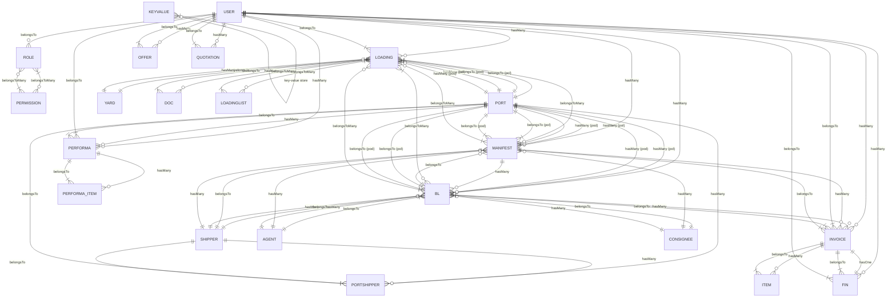
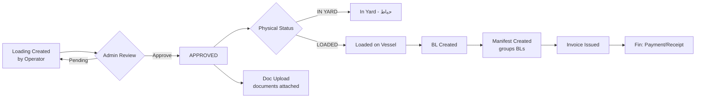
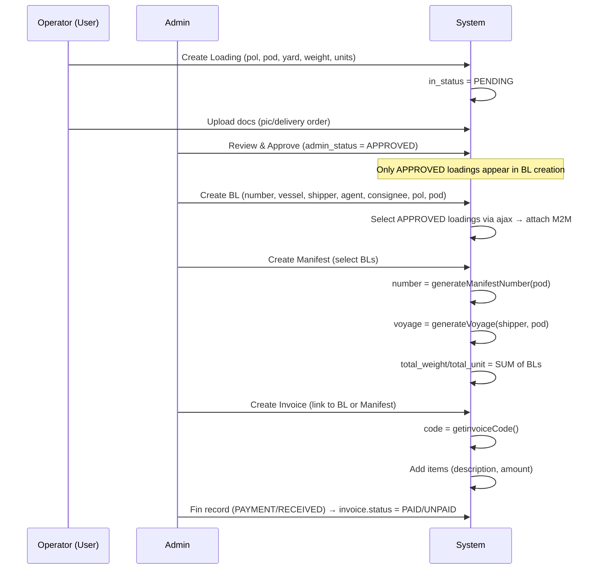

# Legacy Laravel system — source material

Everything recorded about the legacy system this one replaces: schema, data dictionary, calculations, permissions, modules, reports and source references.

> Merged from 11 files on 2026-10-20. Every original document appears below in full, under a heading naming its former path.

---

## duna-analysis/03-legacy-laravel-system/architecture.md

# Legacy Laravel — Architecture

> Technical structure of the old system. This explains *how* it was built, which in turn explains
> *why* it cannot express many of the employer's requirements.

---

## 1. Stack

| Layer | Choice |
|---|---|
| Framework | Laravel 10.10 (`laravel/framework ^10.10`), PHP ^8.1 |
| Auth | Laravel session auth + Sanctum (`laravel/sanctum ^3.3`); `api_token` column on `users` |
| Views | Blade, 68 views, 15,409 LOC, Bootstrap 5 admin template |
| Forms | `laravelcollective/html ^6.4` (`{!! Form::open(...) !!}`) |
| Excel | `maatwebsite/excel ^3.1` (used only for a non-existent export class — defect **D9**) |
| Dates | `morilog/jalali 3.*` for Persian calendar; `engdate()` / `engdate2()` helpers for Gregorian display |
| HTTP | `guzzlehttp/guzzle ^7.2` |
| Front-end | jQuery + jQuery `printPreview` plugin for printing; CKEditor-style rich text for Offer/Quotation bodies |
| DB | Configurable; `config/database.php` present, connection details in `.env` (redacted here) |
| Queue / cache | Standard Laravel drivers, configured by env |

---

## 2. Request flow

```
Browser
  └─► routes/web.php
        ├── middleware 'admin' (AdminMiddleware)  → /admin/*        (back office)
        └── middleware 'user'  (UserMiddleware)   → /profile/*      (customer portal)
              │
              └─► Controller (app/Http/Controllers/Admin|Front)
                    ├─► Eloquent model (app/Models)
                    ├─► helpers (app/Helpers/helpers.php, app/Helpers/order.php)
                    └─► Blade view (resources/views/...)
```

Middleware aliases are registered in `app/Http/Kernel.php`: `admin`, `user`, plus the stock Laravel
set. Both custom middleware are **level checks only** — they do not inspect permissions.

```php
// AdminMiddleware
if (Auth::user()->level == 'Admin') return $next($request); else abort(403);

// UserMiddleware
if (Auth::user()->level == 'User')  return $next($request); else abort(403);
```

---

## 3. Authorization model

Two independent layers, applied inconsistently:

| Layer | Mechanism | Where used |
|---|---|---|
| **Tier** | `level` column checked by middleware | All `/admin/*` and `/profile/*` routes |
| **Permission** | `roles` ↔ `permissions` pivot, checked in Blade with `@can('…')` | Individual buttons and menu items |

**Permissions gate the UI, not the server.** The permission checks seen in the views are Blade
`@can(...)` directives around buttons. Controllers generally do **not** re-check permissions, so a
permission is a UI affordance rather than a server-side guarantee.

Permissions are dot-namespaced strings, e.g.:

```
loadings.show   loadings.new   loadings.edit   loadings.delete
loadings.yards  loadings.ports loadings.adminapprove
loadinglist.show
manifest.show   manifest.create manifest.shipper
manifest.agents.show  manifest.consignee.show  manifest.report
bl.new          bl.delete
release.manager
invoice.show    invoice.create invoice.edit  invoice.delete
invoice.payment
ledger.show     ledger.payment ledger.reciept  ledger.edit  ledger.delete
offer.show      quotation.show  performa.show
user.index      user.create     users.newcustomer
permission.index  role.index     setting.general
dashboard (implicit)
```

See [`permissions.md`](permissions.md) for the full list and the role mapping.

---

## 4. Application structure

```
app/
├── Http/
│   ├── Controllers/
│   │   ├── Admin/  (13 controllers)
│   │   │   ├── DashboardController   ManifestController
│   │   │   ├── FinController         InvoiceController
│   │   │   ├── LoadingController     UserController
│   │   │   ├── OfferController       QuotationController
│   │   │   ├── PerformaController    RoleController
│   │   │   ├── PermissionController  ConfigController
│   │   │   └── AuthController
│   │   └── Front/
│   │       └── ProfileController     (customer portal)
│   └── Middleware/  AdminMiddleware, UserMiddleware
├── Models/          23 Eloquent models
├── Helpers/
│   ├── helpers.php  (kv, kvset, engdate, sperateNumber, generate*Number, …)
│   └── order.php
resources/views/
├── admin/           (modules: loading, manifest, invoices, fins, users, roles,
│                     permissions, settings, offer, quotation, performa, dashboard)
├── profile/         (customer portal views)
└── layouts/         admin.blade.php
routes/
├── web.php          (all application routes)
├── api.php          (a single stock /user route — effectively unused)
└── console.php
database/
├── migrations/      4 stock migrations only
└── seeders/         empty DatabaseSeeder
```

---

## 5. Patterns worth knowing

### 5.1 Fat controllers, thin models
Business logic lives in controllers (e.g. `ManifestController` handles manifest creation, B/L
creation, manifest↔B/L attachment, consolidation and reporting). Models declare `$fillable`,
relations and status constants, and little else.

### 5.2 Line items are client-side string encodings
Invoice and Performa lines are posted as delimited strings and split server-side:

```php
$tgh = explode('~~', $it);      // invoice: qty~~descr~~unit~~vat
$item->qty    = intval($tgh[0]);
$item->descr  = $tgh[1];
$item->unit   = (float) $tgh[2];
$item->vat    = $tgh[3];
```

There is no server-side validation of these strings — a malformed line produces a PHP notice or a
silent zero.

### 5.3 Settings as a key/value table
`KeyValue` + the `kv()` / `kvset()` helpers. Settings — including logo, letterhead, signature and
watermark images — are read on every page render. File uploads for settings are handled inline in
`ConfigController@saveSettings` with a hard-coded list of keys.

### 5.4 Soft delete by convention, not by trait
`deletedAt` columns exist on several models, but the pattern is inconsistent — some controllers
`->delete()` directly, others filter `whereNull('deletedAt')`.

### 5.5 Printing via jQuery `printPreview`
Print output is produced by a jQuery plugin that clones a DOM region
(`$('#print').printPreview({ obj2print:'#printarea' })`). There is **no server-side PDF generation at
all** — no DOMPDF, no Snappy, no headless browser.

> This is the direct reason the employer asks for PDF output with stamps and Print output without
> them (`REQ-121`, `REQ-122`): today everything is a browser print, and the stamp is applied to paper
> afterwards.

### 5.6 Excel export declared but not implemented
`maatwebsite/excel` is a dependency and `UserController@export` exists, but it references
`App\Exports\UsersExport`, which is not in the archive (defect **D9**).

---

## 6. Known architectural gaps versus the employer's needs

| Employer need | Legacy architecture | Consequence |
|---|---|---|
| **PDF / Excel / Print outputs** (`REQ-120`) | Print only (jQuery); no PDF engine | Cannot satisfy as built |
| **Uploadable document templates** (`REQ-124`) | Only a few global image settings (letterhead, signature, watermark) | No per-document-type templating |
| **Vessel & Voyage masters** (`REQ-037`, `REQ-040`) | Free-text strings; voyage counter on `Portshipper` | Cannot key the voyage per vessel+destination |
| **Job costing** (`REQ-130`) | No Job entity | Not representable |
| **Agent portal, port-scoped** (`REQ-187`) | One `User`-level portal, unscoped | Not representable |
| **Server-enforced scoping** | Permissions only gate Blade buttons | A determined user can reach unscoped data |
| **Audit trail** | No `AuditLog`; `createdBy`-style fields on some tables only | Not representable |
| **Attachments** (`REQ-168` ID cards) | Ad-hoc: `Fin.ID_doc` path, `Loading` docs upload | No general attachment service |
| **Multi-currency** | Free-text currency fields on Invoice/Performa/BL | No rate handling |
| **Notifications / alerts** (`REQ-154`, `REQ-184`) | None | Not representable |

---

## 7. What the new system deliberately does differently

For the full comparison see
[`../05-current-project/legacy-vs-current-comparison.md`](../05-current-project/legacy-vs-current-comparison.md).
In summary: the new system replaces helpers with a configurable `NumberingSequence`, replaces image
settings with versioned `DocumentTemplate`s, adds first-class Vessel/Voyage/Job/Invoice entities,
adds `AuditLog` and `FileAttachment`, and enforces permissions server-side.

---

## duna-analysis/03-legacy-laravel-system/business-rules.md

# Legacy Laravel — Business Rules (as implemented)

> Rules the legacy code **actually enforces**, as opposed to rules the employer asked for.
>
> **This is evidence, not specification.** A legacy rule is proof that someone once behaved that way;
> it is not proof that the behaviour is still wanted. Where a legacy rule conflicts with an employer
> statement, the employer wins.

---

## 1. Rules the code enforces

| # | Rule | Where | Verdict vs employer |
|---|---|---|---|
| L1 | Cargo (Loading) requires a customer, POL, POD | `LoadingController` / intake form | ✅ matches `REQ-060` |
| L2 | Selecting a POL filters the Yard picker | Intake form | ✅ matches `REQ-036` |
| L3 | Days in port = loading date − arrival date, else today | `loading/index.blade.php` | ✅ matches `REQ-070`; fallback is an inference |
| L4 | Cargo not loaded stays `INYARD` | `loading_status` | ✅ matches `REQ-093` |
| L5 | A B/L belongs to a manifest | `ManifestController@createbl` | ❌ opposite of the employer's B/L-before-Manifest order |
| L6 | B/L parties default from the manifest | `createbl` | ❌ employer wants parties per B/L |
| L7 | B/L `status` is always `PENDING` | `createbl` | ❌ contradicts `REQ-180`–`REQ-182` |
| L8 | One manifest per voyage (by convention) | `ManifestController` | ✅ directionally matches `REQ-110` |
| L9 | Manifest carries gas / lashing / shipper / pod / pol costs | `manifests` table | ⚠️ partial match with `REQ-191` |
| L10 | Manifest totals recomputed on every write | `ManifestController` | ✅ matches `REQ-112` |
| L11 | Invoice lines carry a VAT percentage | `invoiceitems.vat` | ✅ matches `REQ-144` |
| L12 | Invoice totals recomputed on every write | `InvoiceController` | ✅ but the maths is wrong — see [`calculations.md`](calculations.md) §2 |
| L13 | Invoice status is `PAID` or `UNPAID` only | `Invoice` model | ❌ no Partial state vs `REQ-149` |
| L14 | Issuing an invoice writes a `Fin` row with `debit` | `InvoiceController` | ✅ matches `REQ-150` |
| L15 | Receipt writes a `Fin` row with `credit` | `FinController@submitReciept` | ✅ matches `REQ-151` |
| L16 | Payment writes a `Fin` row with `debit` | `FinController@submitPayment` | ✅ matches `REQ-166` (money out = debit) |
| L17 | Payment form can upload an ID document | `Fin.ID_doc` | ⚠️ partial match with `REQ-168` |
| L18 | Ledger rows can be edited and deleted | `ledger.edit`, `ledger.delete` | ⚠️ not addressed by the employer; mutability of posted ledger rows is questionable practice |
| L19 | A ledger row may be created with no allocation | `FinController` | ✅ matches `REQ-165` |
| L20 | Balance = debit − credit, recomputed after every write | `CalculateDebitCredit()` | ✅ matches `REQ-161` (display is buggy, not the rule) |
| L21 | Five manifest cost columns drive the P&L | `manifest/report.blade.php` | ⚠️ partial match with `REQ-191` |
| L22 | P&L income = Σ manifest-linked invoice totals | `manifest/report.blade.php` | ✅ matches `REQ-192` |
| L23 | Roles carry a permission set; UI elements are gated by `@can` | Blade views | ⚠️ employer only asked for an "Access Control" section (`REQ-001`) |
| L24 | Only `level='Admin'` reaches `/admin/*` | `AdminMiddleware` | ✅ |
| L25 | Only `level='User'` reaches `/profile/*` | `UserMiddleware` | ✅ |
| L26 | New users get the role named by `kv('default_role')` | `UserController` | – |
| L27 | Deleting a role reassigns its users to role id 8 | `RoleController@destroy` | ⚠️ hard-coded — a defect, not a rule |
| L28 | Performa totals include insurance; `total = Σ lines + insurance` | `PerformaController` | ⚠️ not stated by the employer |
| L29 | Offers and Quotations are single free-text HTML bodies | `Offer`, `Quotation` models | ❌ cannot reproduce the line-item table in the real `DSQUO/25-017` |

---

## 2. Rules the code does NOT enforce (gaps)

| # | Missing enforcement | Employer requirement |
|---|---|---|
| G1 | **Inspection does not gate the load list.** Nothing checks `inspection_status` before a cargo is added to a load list | `REQ-082` — a hard precondition, must raise an error |
| G2 | No validation that an optional field is optional — but equally no validation that it is well-formed | `REQ-200` |
| G3 | No B/L draft lifecycle, no DRAFT watermark | `REQ-104` |
| G4 | No release action — `status` never leaves `PENDING` | `REQ-180`–`REQ-182` |
| G5 | No partial-payment state on invoices | `REQ-149` |
| G6 | No per-destination / per-agent data scoping | `REQ-187` |
| G7 | No job or cost-note concept | `REQ-130`–`REQ-135` |
| G8 | No cargo comment surfaced to accounting | `REQ-067` |
| G9 | No vessel master; vessel names are free text with no validation | `REQ-037`, `REQ-040` |
| G10 | No sequential, reproducible numbering | `REQ-013`, `REQ-102`, `REQ-114` |
| G11 | No due date / payment deadline on invoices | `REQ-147` |
| G12 | No alerts of any kind | `REQ-154`, `REQ-184` |
| G13 | No audit trail | — |
| G14 | No overtime / salary / payroll | `REQ-169`, `REQ-170` |
| G15 | No delivery order | `REQ-185`, `REQ-186` |

---

## 3. Conventions visible in the data (not enforced, but followed)

These are conventions inferred from how the code writes data. They are **weak** evidence.

| Convention | Evidence |
|---|---|
| Port name is stored as one "Port, City, Country" string | `ports.title` values; `REQ-030` asks for three fields |
| Port abbreviation is uppercase and short (3 letters) | `HAM` in the employer's own example |
| Yard names are short alphanumeric codes (`F15`, `B15`, `A09`) | Yard examples; `A09 YRD` in the SOA narration |
| Vessels are named, sometimes with a number (`MEHDI 11`, `DAHAR 10`, `ZAM ZAM`) | Free-text values |
| Tug and barge are written as two names when applicable | The real manifest ("BARGE MEHDI 11 / TUG LAYAN GULF") |
| Voyage is `nn/yy` | Everywhere |
| Customers are referred to by `user_code` in UIs | Every customer dropdown renders `fname lname — user_code` |

---

## 4. How to use this file

1. **Do not port L5, L6, L7, L13, L27 or L29.** They are known defects or known divergences.
2. **Port L1–L4, L14–L16, L19, L20, L22** — these match employer requirements.
3. **Treat L9, L17, L21, L23, L28 as open questions**, not rules.
4. **Close the G-list in the new system where the employer asked for it** — see
   [`../05-current-project/legacy-vs-current-comparison.md`](../05-current-project/legacy-vs-current-comparison.md).

---

## duna-analysis/03-legacy-laravel-system/calculations.md

# Legacy Laravel — Calculations & Number Generation

> Every number the legacy system produces, and how. This is the file to read before porting any
> legacy behaviour into the new system — **several legacy calculations are wrong**, and copying them
> would import defects, not business rules.

---

## 1. Number generation (all in `app/Helpers/helpers.php`)

| Helper | Output shape | Example | Sequential? |
|---|---|---|---|
| `generateBLNumber` | `{port.abb}/{year}{rand4}` | `KHS/20261104` | **No — random 4 digits** |
| `generateManifestNumber` | `{port.abb}/{rand6}{year}` | `KHO/4829132026` | **No — random 6 digits** |
| `generateVoyage` | `nn/yy` per **Portshipper** | `02/26` | **Yes** — but keyed wrong |
| `getinvoiceCode` | `DSAED/{rand6}` | `DSAED/517204` | **No — random 6 digits** |
| `getOfferNumber` | `DSOFF/{rand6}` | | **No** |
| `getQuotationNumber` | `DSQUO/{rand6}` | | **No** |
| `getPerformaNumber` | `SDPRO/{rand6}` | | **No — and the prefix is transposed** |
| Customer code | `'CUST00' . (lastUserId + 1)` | `CUST001` | Yes, but by raw id concat |

### Assessment against reality and against the employer

| Item | Legacy | Reality (real PDFs) | Employer | Verdict |
|---|---|---|---|---|
| B/L number | `KHS/20261104` | `KHS/26-110` | `KHS/26-2/2026`, `RJS/26-10` | **All three disagree.** Only the destination-abbrev prefix is common |
| Manifest number | `KHO/4829132026` | `DSMAN/KHO-26-006`, `DSKHS-26-005` | not specified | Legacy and reality disagree |
| Invoice number | `DSAED/{rand6}` | `DSINV/26-172` | not specified | Prefix and shape both differ |
| Proforma number | `SDPRO/{rand6}` | `DSPRO/26-001` | – | **Prefix transposed** (`SD` vs `DS`) |
| Quotation prefix | `DSQUO/{rand6}` | `DSQUO/25-017` | – | Prefix matches; sequence is random vs year-scoped |
| Voyage | `nn/yy` per Port+Shipper | `02/26` | `nn/yy` per vessel+destination+year | **Shape matches; key does not** |

> **Conclusion:** the legacy numbering is a *placeholder* implementation. It should be read as
> evidence that "numbers are auto-generated", **not** as evidence of any format.

---

## 2. Invoice line maths — where the legacy system is wrong

The controller (`InvoiceController@store`) computes, per line:

```
$item->subtotal  = ($qty * $unit) + $vatAmount     // ← ALREADY VAT-INCLUSIVE
$item->vatamount = $vatAmount
$invoice->total    = Σ $subtotal                    // ← therefore also VAT-inclusive
$invoice->totalvat = Σ $vatAmount
```

The **print template** then renders:

| Column | Expression | Correct? |
|---|---|---|
| `UNIT PRICE (AED)` | `sperateNumber($item->subtotal)` | ❌ prints the line **total**, not the unit price |
| `QTY` | `$item->qty` | ✅ |
| `VAT %` | `$item->vat` | ✅ |
| `VAT AMOUNT` | `sperateNumber($item->vatamount)` | ✅ |
| `AMOUNT (INCL VAT)` | `sperateNumber($item->vatamount + $item->subtotal)` | ❌ **VAT counted twice** |
| `SUBTOTAL` (footer) | `sperateNumber($inv->total)` | ⚠️ labelled "subtotal" but is VAT-inclusive |
| `VAT` (footer) | `sperateNumber($inv->totalvat)` | ⚠️ memo only — must **not** be added again |
| `TOTAL AMOUNT` | `sperateNumber($inv->totalvat + $inv->total)` | ❌ **VAT counted twice again** |

**The correct model** (confirmed by the real Tax Invoice `DSINV/26-172`, where
22,020 + 650 + 200 + 4,500 = 27,370 with VAT 0 on every line):

```
lineNet       = unitPrice × qty
lineVat       = lineNet × vat% / 100
lineAmount    = lineNet + lineVat            // "Amount (incl VAT)"
Sub Total     = Σ lineAmount                 // already VAT-inclusive
VAT (footer)  = Σ lineVat                    // memo
Total Amount  = Sub Total                    // NOT Sub Total + VAT
```

> **Do not port the legacy invoice arithmetic.** See
> [`../02-business-documents/invoices.md`](../02-business-documents/invoices.md) §5.

---

## 3. Ledger maths

`CalculateDebitCredit()` recomputes `users.debit` and `users.credit` by summing the `fins` rows for
that user. Called after every ledger write.

Running-balance display (`admin/fins/preview.blade.php`):

```
$debit  = Σ $fin->debit
$credit = Σ $fin->credit
balance = $debit > $credit ? $debit - $credit
        : $debit > $credit ? $debit - $credit   // ← duplicate condition
        : 0                                     // ← credit > debit always prints 0
```

Two defects:
1. **The second branch is a copy of the first**, so a credit-side balance always renders `0`
   instead of a negative figure. The same duplicated-condition pattern appears in
   `admin/manifest/report.blade.php` and `admin/invoices/index.blade.php`.
2. **The statement is ordered newest-first** (`orderby('created_at','desc')`) while accumulating a
   running balance from the top of the list — so the running balance column is meaningless. A
   statement must be ordered **ascending** to carry a balance.

The real TallyPrime statement
([`../02-business-documents/statements-of-account.md`](../02-business-documents/statements-of-account.md))
does the opposite and does it correctly: ascending, running balance, both signs shown.

---

## 4. Voyage number — the key is wrong

`generateVoyage` is keyed on the **`Portshipper`** record (a port + shipper pairing), producing
`nn/yy`.

The employer's rule (`REQ-040`, `EMP-315`–`EMP-331`) is:

> `n/yy` counted **per vessel + per destination + per year**, restarting at 1 for each new
> destination and each new year.

Because the legacy system has **no Vessel master at all** (vessel is a free-text string on
`Loading`, `Manifest` and `Bl`), it *cannot* implement the employer's rule. The legacy behaviour is
therefore not a competing business rule — it is a **consequence of a missing entity**.

The new system's `NumberingSequence` model supports `scopeType` values
`GLOBAL | DESTINATION | YEAR | YEAR_PERIOD`, which can express the employer's rule.

---

## 5. Manifest report (voyage P&L)

`admin/manifest/report.blade.php` computes:

```
total_cost   = gas_cost + lashing_cost + shipper_cost + pod_cost + pol_cost
total_income = Σ invoice.total            // net of VAT
total_income_paid   = Σ invoice.total where status = PAID
total_income_unpaid = Σ invoice.total where status = UNPAID
profit/loss  = total_income − total_cost
```

Observations:

| Point | Assessment |
|---|---|
| Cost categories | Five fixed columns on the manifest. The employer named charter, Port Use, Handling, Lashing and miscellaneous (`REQ-191`) — **three of the five match**, "charter" and "misc" have no legacy column |
| Income basis | Uses `invoice.total`, which is **VAT-inclusive** in the legacy model (see §2) — so legacy income is overstated by the VAT amount |
| Income scope | Only invoices whose `manifest_id` is set — i.e. invoices linked to that manifest's B/Ls ✓ matches `REQ-192` |
| Paid/unpaid split | ✓ aligns with the employer's "Paid / Partial / Unpaid" reporting need (`REQ-183`) |
| Partial payments | **Not representable** — `Invoice.status` is only `PAID` or `UNPAID` |

---

## 6. Days in port

`admin/loading/index.blade.php` and `admin/loading/preview.blade.php` both compute:

```php
$create = Carbon::parse($lo->arrival_date);
$loadi  = $lo->loading_date
            ? Carbon::parse($lo->loading_date)
            : Carbon::now();
$diff   = $create->diffInDays($loadi);
```

i.e. **days in port = loading date − arrival date, falling back to *today* when not yet loaded.**

This matches `REQ-069` / `REQ-070` exactly, and adds the fallback behaviour (which the employer did
not state — it is an **inference** in [`../01-employer-statements/business-rules.md`](../01-employer-statements/business-rules.md) R3.7).

---

## 7. Aggregates

| Aggregate | Where computed | Rule |
|---|---|---|
| `Manifest.total_unit`, `total_weight` | On every write | Σ over the manifest's loadings/B-Ls |
| `Bl.total_unit`, `total_weight` | On every write | Σ over the B/L's items |
| `Invoice.total`, `totalvat`, `btotal` | On every write | See §2 |
| `Performa.total`, `total_net`, `total_gross` | On every write | `total = Σ line totals + insurance` |
| `User.debit`, `User.credit` | After every ledger write | `CalculateDebitCredit()` |

---

## 8. Rounding and formatting

- Money is stored as MySQL `DECIMAL`; no explicit rounding helper is used in PHP — rounding is
  delegated to the database.
- Display uses `sperateNumber()` (thousands separator).
- Dates display through `engdate()` and `engdate2()` (Gregorian) and the `morilog/jalali` package is
  available for Persian dates.

---

## 9. Summary — what to port and what to reject

| Behaviour | Port? | Reason |
|---|---|---|
| Days-in-port = loading − arrival, fallback to today | **Yes** | Matches `REQ-070`; the fallback is a sensible inference |
| Manifest P&L = Σ manifest invoices − five stored costs | **Partly** | Structure is right; income must be **net of VAT** and the cost categories must be configurable |
| Ledger: invoice → debit, payment/receipt → credit | **Yes** | Matches `REQ-150` / `REQ-151` |
| Running balance on a statement | **Yes, but fix it** | Must be ascending order and must handle both signs |
| Invoice line/total arithmetic | **No** | Double-counts VAT |
| Any number-generation format | **No** | Random components; prefixes disagree with real documents |
| Voyage counter keyed on port + shipper | **No** | Wrong key; the employer's key is vessel + destination + year |
| Customer code `'CUST00' . id` | **No** | Not configurable, collision-prone |
| 'CUST00' prefix itself | **Yes** | Matches `REQ-014`'s prefix |

---

## duna-analysis/03-legacy-laravel-system/data-dictionary.md

# Legacy Laravel — Data Dictionary

> Field-level meanings for the legacy schema. Read
> [`database-schema.md`](database-schema.md) first for the table-level picture.
>
> **Caution:** this is the *legacy* meaning of each field. Where the current system uses different
> semantics for a same-named concept, that is called out in
> [`../05-current-project/legacy-vs-current-comparison.md`](../05-current-project/legacy-vs-current-comparison.md).

---

## 1. Parties

### `users` — one table for staff, admins and customers

| Field | Meaning in the legacy system | Employer's concept |
|---|---|---|
| `level` | `Admin` = back-office user; `User` = customer/portal user. Drives middleware. | Not a concept the employer uses |
| `user_code` | Customer code, generated as `'CUST00' . (lastId+1)` → `CUST001`, `CUST0010`, … | `REQ-013`/`REQ-014` — system-generated `CUST` code. Direction matches; format and collision-safety do not |
| `fname` / `lname` | Given / family name | Customer "Name" (`REQ-011`) |
| `compayname` | Company name — **field name is misspelled in the code** | Customer may be a legal entity (`REQ-019`) |
| `mobile`, `email`, `address` | Contact details | Optional customer fields (`REQ-012`) |
| `nationalCode` | National ID | The employer moved this to Shipper/Consignee, not Customer (`REQ-017`, `REQ-051`) |
| `role_id` | FK to `roles` | Access Control section (`REQ-001`) |
| `debit` / `credit` | Running ledger totals, recomputed by `CalculateDebitCredit()` | Debit/Credit/Balance (`REQ-150`, `REQ-151`, `REQ-161`) |
| `active` | Soft enable flag | – |
| `api_token` | Sanctum-style token | – |

**Critical:** because Customer *is* a `User` row, the legacy system has **no way to represent a
customer who is not also a portal login**, and no way to keep the internal customer separate from the
documentary parties. This is the structural gap the party cutover in the new system fixed.

---

## 2. Master data

### `ports`

| Field | Meaning |
|---|---|
| `title` | Display name, e.g. `Hamriyah Port, Dubai, UAE` — the employer's three-part string stored as one value |
| `abb` | Abbreviation used in number generation and (by the employer's request) in the Load List, e.g. `HAM` |

> The employer wants Port / City / Country as three fields (`REQ-030`); the legacy system stores one
> concatenated `title`.

### `yards`

| Field | Meaning |
|---|---|
| `port_id` | Owning port |
| `title` | Yard name, e.g. `F15`, `B15` |

Matches `REQ-035`.

### `shippers` / `consignees` / `agents`

| Field | Meaning |
|---|---|
| `title` (Shipper) / `name` (Consignee) / `company` (Agent) | Party name — **three different column names for the same concept** |
| `address`, `phone`, `email` | Contact details |
| identifier fields | National ID / TRN equivalents |

Matches `REQ-050`–`REQ-056` in spirit; the employer wants one consistent field set across all three.

### `portshippers`

| Field | Meaning |
|---|---|
| `port_id`, `shipper_id` | The port+shipper pairing |
| voyage counter | **The voyage sequence lives here** |

> ⚠️ The voyage counter is keyed on **port + shipper**, not on **vessel + destination** as the
> employer requires (`REQ-040`). See [`calculations.md`](calculations.md) §4.

---

## 3. Cargo / Loading

### `loadings` — the operational record

| Field | Meaning | Employer's concept |
|---|---|---|
| `user_id` | The customer | `REQ-060` — customer is the first field ✓ |
| `pol_id` / `pod_id` | Port of loading / discharge | ✓ |
| `yard_id` | Storage yard | ✓ (`REQ-036`) |
| `portshipper_id` | Drives voyage number generation | No equivalent |
| `description` | Goods description | ✓ |
| `chno` | Chassis number | ✓ |
| `qty` / `qty_descr` | Quantity + its description | Partially — the employer wants units *and* packages separately (`REQ-071`) |
| `gross` / `net` | Weights | ✓ |
| `measurment` | CBM (**misspelled in the code**) | ✓ |
| `showroom` | Origin showroom | Mentioned in the Quotation specimen only |
| `arrival_date` | Intake date | ✓ (`REQ-069`) |
| `loading_date` | Load date | ✓ (`REQ-069`) |
| `inspection_status` | `PENDING` / `DONE` / `LOCAL` / `NONEED` | ✓ (`REQ-081`), plus two extra states |
| `loading_status` | `LOADED` / `INYARD` | ✓ (`REQ-093` — returning to yard) |
| `admin_status` | `PENDING` / `APPROVED` — management review gate | **Not requested by the employer.** Legacy-only concept |
| `note` | Free-text note | A weak precursor to the employer's Comment (`REQ-065`) — but it is not surfaced to accounting in a structured way |
| `vessel`, `voyage` | Free-text strings | The employer wants Vessel master + derived voyage (`REQ-037`, `REQ-040`) |
| `manifest_id` | Set when attached to a manifest | ✓ |
| `total_unit`, `total_weight` | Aggregates | ✓ |

**Missing versus the employer's field list:** Shipper, Serial Number, Units-vs-Packages split,
Weight Unit, Document Status, and a first-class Comment.

---

## 4. Documents

### `manifests`

| Field | Meaning |
|---|---|
| `number` | `{port.abb}/{rand6}{year}` — **random**, not sequential |
| `vessel` / `voyage` | Free-text strings (no Vessel master) |
| `pol_id` / `pod_id` | Ports |
| `shipper_id` / `consignee_id` / `agent_id` | Party masters at manifest level |
| `notify_party` | Notify party text |
| `similar_con` | Flag: notify party is the same as consignee |
| `gas_cost`, `lashing_cost`, `shipper_cost`, `pod_cost`, `pol_cost` | **The five voyage cost columns** — the legacy system's answer to `REQ-191` |
| `total_unit`, `total_weight` | Aggregates recomputed on write |
| `descr` | Description |

### `bls`

| Field | Meaning |
|---|---|
| `number` | `{port.abb}/{year}{rand4}` — random |
| `status` | Only ever `PENDING` — `RELEASED` is defined but never written (defect **D1**) |
| `bl_status` | `-` or `SURRENDERED` — a **different** concept from `status` (defect **D2**) |
| `vessel` / `voyage` | Free text |
| `similar_con`, `notify_party` | As per manifest |
| `total_unit`, `total_weight` | Aggregates |

### `invoices` / `invoiceitems`

| Field | Meaning |
|---|---|
| `code` | `DSAED/{rand6}` — **the field is `code`, but the preview template reads `number`** (defect **D3**) |
| `title` | Free heading printed at the top of the invoice |
| `todescr` | Bill-to description block |
| `status` | `PAID` / `UNPAID` — **no Partial state**, unlike `REQ-149` |
| `total` | **Net** of VAT |
| `totalvat` | VAT amount |
| `btotal` | Sub-total before VAT |
| Item `unit` | Unit price |
| Item `vat` | VAT **percentage** for the line ✓ `REQ-144` |
| Item `vatamount` | VAT amount for the line |
| Item `subtotal` | **Already includes VAT** — see [`calculations.md`](calculations.md) §2 |

---

## 5. Finance

### `fins` — the ledger

| Field | Meaning |
|---|---|
| `type` | `invoice` \| `payment` \| `reciept` (**misspelled** — "reciept") |
| `status` | `Sales` or `Payment` on the debit side; `Received` on the credit side |
| `debit` | Money out of the party's favour (invoice issued, payment made by Duna) |
| `credit` | Money in the party's favour (payment received) |
| `invoice_id` | Populated only when `type='invoice'` |
| `descr`, `note` | Description and note |
| `ID_doc` | Path to an uploaded **ID-card image** — legacy has some ID-capture support after all, though only in this one place |
| `amount` | Amount as entered |

**Structure:** a flat list of movements per party. No allocation table, no journal, no chart of
accounts.

### Ledger semantics (verified in code)

| Action | Effect |
|---|---|
| Invoice issued | `Fin` row, `type='invoice'`, `debit` = invoice total |
| Payment made by Duna | `Fin` row, `type='payment'`, `debit` = amount |
| Money received | `Fin` row, `type='reciept'`, `credit` = amount |
| After any write | `CalculateDebitCredit()` recomputes `users.debit` / `users.credit` |

---

## 6. Pre-sales documents

### `offers` / `quotations`

| Field | Meaning |
|---|---|
| `title` | Document title |
| `body` | **The entire document as rich HTML** — there are no line items |
| `number` | `DSOFF/{rand6}` and `DSQUO/{rand6}` respectively |
| `user_id` | Customer |

> The legacy system cannot produce the Quotation line-item table seen in the real `DSQUO/25-017`
> specimen — the whole document is a free-text HTML body.

### `performas` / `performa_items`

| Field | Meaning |
|---|---|
| `number` | `SDPRO/{rand6}` — **prefix transposed** relative to the real `DSPRO/…` documents |
| `buyer`, `forwarder` | Buyer and freight forwarder |
| `port_id` | Discharge port |
| `currency` | Transaction currency |
| `pi` | Proforma-invoice reference |
| `benefit` | Beneficiary |
| `origin` | Country of origin |
| `termdelivery`, `termpayment` | Delivery terms / payment terms |
| `partial` | Partial shipment |
| `finalplace` | Final delivery place |
| `insurance` | Insurance amount |
| `btotal`, `total`, `total_net`, `total_gross` | Money and weight totals |
| Item fields | `descr`, `qty`, `price`, `gross`, `net`, `total` |

**This is the one place where the legacy schema is closer to the real paperwork than the employer's
transcripts are** — the Performa model captures most of the Proforma fields seen on `DSPRO/26-001`.

---

## 7. Settings — `key_values`

| Key | Used for |
|---|---|
| `app_title` | Company name printed on documents |
| `address`, `tel1`, `tel2`, `email` | Letterhead block |
| `light_logo`, `dark_logo`, `favicon`, `mag_logo`, `shop_header`, `login_poster` | Branding |
| `letterhead` | Image at the top of the printed invoice |
| `signature` | Signature image on printed documents |
| `watermark` | Watermark image (**note:** this is a general watermark, not the B/L `DRAFT` watermark) |
| `default_avatar` | User avatar fallback |
| `aed_account_details` | Bank account block on the invoice |
| `admin_paginate_number` | Page size |
| `default_role` | Role assigned to new users |

> The presence of uploadable `letterhead`, `signature` and `watermark` settings is the legacy
> precursor to the employer's document-template requirement (`REQ-124`). The new system's
> `DocumentTemplate` / `DocumentTemplateVersion` models are the generalised form.

---

## duna-analysis/03-legacy-laravel-system/database-schema.md

# Legacy Laravel — Reconstructed Database Schema

> **Why "reconstructed":** the archive contains only the four **stock** Laravel migrations
> (`users`, `password_reset_tokens`, `failed_jobs`, `personal_access_tokens`). The application's real
> schema was created outside migrations — see
> [`system-overview.md`](system-overview.md) §4.
>
> Everything below is derived from: the 23 Eloquent models (`$fillable`, casts, relations,
> constants), the 15 controllers (mass-assignment calls), and the 68 Blade views (field names in
> forms and tables).
>
> **Confidence:** High for field names and relations that appear in `$fillable` or in a form.
> **Medium** for fields only seen in a Blade view (they may not be a `$fillable` column — e.g. the
> non-`$fillable` Loading fields in §3). **Unknown** for types, nullability, indexes and defaults.

---

## 1. Access control

### `users`
Core table. Serves **admins, staff and customers** alike; the discriminator is `level`.

| Column | Type (inferred) | Notes |
|---|---|---|
| `id` | bigint PK | |
| `fname`, `lname` | string | First / last name |
| `compayname` | string? | **Sic — misspelling of `companyname` in the code** |
| `mobile` | string? | |
| `email` | string? | |
| `nationalCode` | string? | |
| `address` | text? | |
| `password` | string | |
| `avatar` | string? | |
| `role_id` | bigint FK → roles | |
| `level` | string | `Admin` \| `User` — the access tier |
| `active` | boolean | |
| `api_token` | string? | |
| `auth` | string? | |
| `user_code` | string | **Customer code**: `'CUST00' . (lastId+1)` |
| `debit` | decimal | maintained by `CalculateDebitCredit()` |
| `credit` | decimal | maintained by `CalculateDebitCredit()` |
| `created_at`, `updated_at` | timestamps | |

Relations: `role`, `permissions` (via role), `cargos`/`loadings`, `bls`, `invoices`, `fins`,
`offers`, `quotations`, `performas`.

### `roles`, `permissions`, `role_permission`, `user_role`
- `roles`: `id`, `name`, `label`, timestamps
- `permissions`: `id`, `name`, `label`, timestamps
- `role_permission`: `role_id`, `permission_id`
- `user_role`: `user_id`, `role_id`

Permission names are dot-namespaced strings, e.g. `loadings.show`, `bl.new`, `manifest.report`,
`release.manager`, `ledger.reciept` (**sic — "reciept"**), `bl.delete`.

### `key_values` (model `KeyValue`)
Runtime settings store, read through the `kv()` helper and written through `kvset()`.
Known keys: `app_title`, `address`, `tel1`, `tel2`, `email`, `admin_paginate_number`,
`default_role`, `default_avatar`, `light_logo`, `dark_logo`, `letterhead`, `signature`, `watermark`,
`favicon`, `mag_logo`, `shop_header`, `login_poster`, `aed_account_details`.

---

## 2. Master data

### `ports`
`id`, `title`, `abb` (abbreviation, used in number generation), `created_at`, `updated_at`.
Relations: `yards`, cargos as POL/POD, voyage origins/destinations, manifests as POL/POD,
`agent_destinations`.

### `yards`
`id`, `port_id`, `title`, timestamps. Relations: `port`, cargos, inventories.

### `shippers`
`id`, `title`, plus contact fields seen in the admin views (name/address/phone/email-style fields);
timestamps. Relations: cargos, manifests, B/Ls.

### `consignees`
`id`, `name`, `address`, `phone`, plus identifier fields; timestamps. Relations: cargos, manifests,
B/Ls.

### `agents`
`id`, `company`, `address`, `phone`, timestamps. Relations: manifests, B/Ls.

### `portshippers` (model `Portshipper`)
`id`, `port_id`, `shipper_id`, **voyage counter**, timestamps.
> This table carries the voyage sequence — see [`calculations.md`](calculations.md) §4 for why that
> contradicts the employer's rule.

### `currencies`
A `currencies` concept exists in the new system; the legacy archive has no Currency model — currency
is a free field on Invoice / Performa / B/L only.

---

## 3. Operations

### `loadings` (model `Loading`) — the central operational record

**`$fillable` columns (confirmed writable):**

| Column | Notes |
|---|---|
| `user_id` | the **customer** |
| `pol_id`, `pod_id` | port of loading / discharge |
| `yard_id` | |
| `portshipper_id` | link that drives voyage generation |
| `description` | |
| `note` | free text — the only "comment" the legacy system has |
| `admin_status` | `PENDING` \| `APPROVED` — management review |
| `total_unit`, `total_weight` | |

**Non-`$fillable` columns seen only in views / loading logic (medium confidence):**

| Column | Notes |
|---|---|
| `inspection_status` | `PENDING` \| `DONE` \| `LOCAL` \| `NONEED` |
| `loading_status` | `LOADED` \| `INYARD` |
| `showroom` | origin showroom |
| `chno` | chassis number |
| `qty`, `qty_descr` | quantity and its description |
| `measurment` | **sic** — CBM |
| `gross`, `net` | weights |
| `arrival_date` | |
| `loading_date` | |
| `manifest_id` | set when the cargo is attached to a manifest |
| `vessel`, `voyage` | free-text strings |

**Status constants (from the `Loading` model):**
- `admin_status`: `INPENDING`, `APPROVED`
- `inspection_status`: `INPENDING`, `INDONE`, `INLOCAL`, `INNONEED`
- `loading_status`: `LOADED`, `INYARD`

### `loadinglists` (model `Loadinglist`)
`id`, plus vessel/date/status fields; timestamps. Relations: `loadings` (via Loading), vessel is a
string.

---

## 4. Documents

### `manifests` (model `Manifest`)

| Column | Notes |
|---|---|
| `number` | from `generateManifestNumber()` — `{port.abb}/{rand6}{year}` |
| `user_id` | customer |
| `portshipper_id` | |
| `pol_id`, `pod_id` | |
| `vessel` | **free-text string** |
| `voyage` | **free-text string** |
| `descr` | |
| `shipper_id`, `consignee_id`, `agent_id` | party masters |
| `notify_party`, `similar_con` | `similar_con` = "notify same as consignee" flag |
| `gas_cost`, `lashing_cost`, `shipper_cost`, `pod_cost`, `pol_cost` | the **five voyage cost columns** |
| `total_unit`, `total_weight` | aggregates |
| `created_at`, `updated_at` | |

Relations: `loadings` (via Loading.manifest_id), `bls`, `invoices`, `users`, `pols`, `pods`,
`shippers`, `consignees`, `agents`.

### `bls` (model `Bl`)

| Column | Notes |
|---|---|
| `number` | from `generateBLNumber()` — `{port.abb}/{year}{rand4}` |
| `user_id` | customer |
| `manifest_id` | |
| `vessel`, `voyage` | free-text strings |
| `pol_id`, `pod_id` | |
| `shipper_id`, `consignee_id`, `agent_id` | |
| `notify_party`, `similar_con` | |
| `descr` | |
| `total_unit`, `total_weight` | |
| `status` | `PENDING` (the only value ever written) |
| `bl_status` | `-` \| `SURRENDERED` |
| `created_at`, `updated_at` | |

> Two status columns that look like one — see defect **D2** in
> [`system-overview.md`](system-overview.md) §7.

### `invoices` (model `Invoice`)

| Column | Notes |
|---|---|
| `code` | from `getinvoiceCode()` — `DSAED/{rand6}` |
| `title` | free heading printed on the invoice |
| `todescr` | "to-description" — the bill-to block |
| `user_id` | customer |
| `bl_id`, `manifest_id` | optional document anchors |
| `status` | `PAID` \| `UNPAID` |
| `total`, `totalvat`, `btotal` | money |
| `created_at`, `updated_at` | |

> There is **no** `number` column — which is why the preview page renders an empty invoice number
> (defect **D3**).

### `invoiceitems` (model `Invoiceitem`)

| Column | Notes |
|---|---|
| `invoice_id` | |
| `descr` | |
| `qty` | |
| `unit` | unit price |
| `vat` | VAT **percentage** for the line |
| `vatamount` | VAT amount for the line |
| `subtotal` | **already includes VAT** — see [`calculations.md`](calculations.md) §2 |
| created/updated | |

Lines are **not** submitted as structured fields: the browser posts strings of the shape
`qty~~descr~~unit~~vat` which the controller splits with `explode('~~', …)`.

---

## 5. Finance

### `fins` (model `Fin`) — the ledger table

| Column | Notes |
|---|---|
| `user_id` | the party |
| `type` | `invoice` \| `payment` \| `reciept` (**sic — "reciept"**) |
| `status` | `Sales`/`Payment` for debits, `Received` for credits |
| `descr` | |
| `debit`, `credit` | money |
| `note` | |
| `invoice_id` | only when `type='invoice'` |
| `ID_doc` | **ID-card attachment path** — the only ID-capture support in the legacy system |
| `amount` | |
| `created_at`, `updated_at` | |

There is **no** separate voucher table, no allocation table, and no journal table. Payments and
receipts are `Fin` rows with `type` set.

---

## 6. Pre-sales documents

### `offers` (model `Offer`)
`id`, `title`, `body` (rich HTML), `user_id`, `number` (from `getOfferNumber()` → `DSOFF/{rand6}`),
timestamps. **No line items — the whole document is one HTML body.**

### `quotations` (model `Quotation`)
`id`, `title`, `body` (rich HTML), `user_id`, `number` (from `getQuotationNumber()` →
`DSQUO/{rand6}`), timestamps. Same shape as Offer.

### `performas` (model `Performa`)
`id`, `number` (from `getPerformaNumber()` → `SDPRO/{rand6}` — **note the transposed `SDPRO`
prefix**), `user_id`, `buyer`, `forwarder`, `port_id`, `currency`, `notes`, `pi`, `benefit`,
`origin`, `termdelivery`, `termpayment`, `partial`, `finalplace`, `insurance`, `btotal`, `total`,
`total_net`, `total_gross`, timestamps.

### `performa_items` (model `Performa_item`)
`id`, `performa_id`, `descr`, `qty`, `price`, `gross`, `net`, `total`, timestamps.
Lines are likewise parsed from `qty~~descr~~price~~gross~~net` strings.

---

## 7. Entity-relationship sketch

```
users ──< loadings >── ports (pol/pod) ──< yards
  │         │  │
  │         │  └──────< portshippers >── shippers
  │         │
  │         └──< manifests >── bls >── shippers / consignees / agents
  │                  │           │
  │                  │           └──< invoices >── invoiceitems
  │                  │
  │                  └──< invoices
  │
  ├──< fins  (ledger rows; invoice / payment / reciept)
  ├──< invoices
  ├──< bls
  ├──< offers
  ├──< quotations
  └──< performas >── performa_items

roles ──< role_permission >── permissions
users ──< user_role >── roles
```

**Notable absences in the graph:** no Vessel table, no Voyage table, no Job table, no Cargo-comment
table, no Delivery Order, no Release Order, no Salary, no AuditLog, no FileAttachment, no
DocumentTemplate.

---

## 8. Confidence and caveats

| Area | Confidence | Why |
|---|---|---|
| Field **names** on `$fillable` models | High | read directly from the models |
| Field names seen only in Blade views | Medium | may be computed, aliased or non-persisted |
| Column **types**, nullability, defaults | Low | no migrations; only PHP casts are visible |
| Indexes, foreign keys, cascades | Low | inferred from relation definitions only |
| Table **names** | Medium | Laravel's default pluralisation is assumed where not declared via `$table` |
| Anything about **data volumes** | None | the ZIP contains code, not a database dump |

> **Do not use this schema as a migration source without verifying against a live legacy database.**
> The archive has no data in it.

---

## duna-analysis/03-legacy-laravel-system/modules-and-pages.md

# Legacy Laravel — Modules & Pages

> Inventory of every screen the legacy system has, what it does, and the permission that gates it.
> Derived from `routes/web.php`, the 15 controllers and the 68 Blade views.

---

## 1. Back office (`/admin/*`, gated by `AdminMiddleware`)

### 1.1 Dashboard

| Page | Route | Content |
|---|---|---|
| Dashboard | `/admin/dashboard` | Six counts: B/Ls, Manifests, Invoices, Loadings, Customers (`level='User'`), Offers. (A Quotation count is computed but not passed to the view.) |

### 1.2 Loading (cargo intake + load lists)

| Page | Route | Permission | Content |
|---|---|---|---|
| All loading | `/admin/loading-list` | `loadings.show` | Filterable list: user, inspection status, loading status, POD, POL, admin status. Columns: id, customer, POL, POD, yard, chassis no., **No. Days**, admin status, inspection status, loading status. Row actions: edit, upload documents, delete, "More Details" drawer |
| Loading detail drawer | (inline) | | Read-only view of every Loading field |
| Management review | `/admin/loading-list/change/{id}` | `loadings.adminapprove` | Set `admin_status` (`PENDING`/`APPROVED`) — a **legacy-only** gate the employer never asked for |
| Add new loading | `/admin/loading-list/new` | `loadings.new` | POL, POD, Yard, Customer, Showroom, CH.No., QTY, QTY Description, Net weight, Gross weight, Measurement, Loading status, Inspection status, Arrival date, Loading date, Description, Note |
| Loading List | `/admin/loading-list/list` | `loadinglist.show` | Create / edit / preview a load list |
| Loading List preview | `/admin/loading-list/list/preview/{id}` | `loadinglist.show` | Printable list: NO, CUSTOMER, SHOWROOM, DESCRIPTION (CHNO), QTY, YARD, DATE ARRIVAL, INSP. STATUS, DATE OF LOAD, **NO OF DAYS** |
| Yards | `/admin/loading-list/yards` | `loadings.yards` | Yard CRUD (port + name) |
| Ports | `/admin/loading-list/ports` | `loadings.ports` | Port CRUD (title + abbreviation) |
| Upload documents | `/admin/loading-list/{id}/docs` | `loadings.new` | File upload against a Loading record |

### 1.3 Manifest / B/L

| Page | Route | Permission | Content |
|---|---|---|---|
| All Manifest | `/admin/manifests` | `manifest.show` | Manifest list |
| Create Manifest | `/admin/manifests/create` | `manifest.create` | New manifest |
| Manifest preview | `/admin/manifests/preview/{id}` | `manifest.show` | Printable manifest (see [`reports-and-documents.md`](reports-and-documents.md)) |
| All BL | `/admin/manifests/bl` | `manifest.show` | B/L list |
| New BL | `/admin/manifests/bl/create` | `bl.new` | New B/L |
| BL preview | `/admin/manifests/bl/preview/{id}` | `manifest.show` | Printable B/L |
| Edit BL | `/admin/manifests/bl/edit/{id}` | | Edit B/L |
| Delete BL | `/admin/manifests/bl/delete/{id}` | `bl.delete` | Delete B/L |
| Shipper | `/admin/manifests/shipper` | `manifest.shipper` | Shipper master |
| Agent | `/admin/manifests/agents` | `manifest.agents.show` | Agent master |
| Consignee | `/admin/manifests/consignee` | `manifest.consignee.show` | Consignee master |

### 1.4 Accounting

| Page | Route | Permission | Content |
|---|---|---|---|
| Ledger | `/admin/ledger` | `ledger.show` | All ledger rows, filterable by customer and date range. Columns: id, customer, date, status, description, ref (invoice code), debit, credit, note |
| Submit payment | `/admin/ledger/submit-payment` | `ledger.payment` | Customer, description, amount, note, **ID-card upload** |
| Submit receipt | `/admin/ledger/submit-reciept` | `ledger.reciept` | Customer, description, amount, note (**no** ID-card field) |
| Ledger preview / statement | `/admin/ledger/preview` | `ledger.show` | Date-ranged ledger account (see [`calculations.md`](calculations.md) §3) |
| Voucher view | `/admin/ledger/{id}` | | Payment/Receipt voucher print |
| Ledger edit / delete | `/admin/ledger/edit/{id}`, `/admin/ledger/delete/{id}` | `ledger.edit`, `ledger.delete` | Only for `payment`/`reciept` rows |
| All Invoices | `/admin/invoices` | `invoice.show` | Filter by customer and status. Columns: code, title, customer, total, total VAT, status, created date |
| New Invoice | `/admin/invoices/create` | `invoice.create` | Title, customer, B/L picker, line items |
| Invoice preview | `/admin/invoices/view/{id}` | `invoice.show` | Printable tax invoice |
| Edit / delete invoice | `/admin/invoices/edit/{id}`, `/admin/invoices/delete/{id}` | `invoice.edit`, `invoice.delete` | |
| Change payment status | `/admin/invoices/change-payment/{id}` | `invoice.payment` | Toggle `PAID` / `UNPAID` |
| Manifest Report | `/admin/manifest-report` | `manifest.report` | Voyage P&L (see [`calculations.md`](calculations.md) §5) |
| Release Manager | `/admin/release-manager` | `release.manager` | Filterable B/L list with a Release status badge. **Has no action to change release status** — only Delete (defect **D1**) |
| Offers | `/admin/offers` | `offer.show` | Free-text body documents |
| Quotations | `/admin/quotations` | `quotation.show` | Free-text body documents |
| Proforma | `/admin/proforma` | `performa.show` | Structured Proforma with line items |

### 1.5 Users & access

| Page | Route | Permission | Content |
|---|---|---|---|
| All Users | `/admin/users` | `user.index` | User list |
| New User | `/admin/users/create` | `user.create` | Back-office user with validation |
| View / edit user | `/admin/users/view/{id}`, `/admin/users/edit/{id}` | `user.index` | |
| **New Customer** | `/admin/new-customer` | `users.newcustomer` | A **second, simpler** customer-creation path with no validation — a shorter form that creates a `level='User'` record directly |
| Permissions | `/admin/permissions` | `permission.index` | Permission CRUD |
| Roles | `/admin/roles` | `role.index` | Role CRUD with permission multi-select |

### 1.6 Settings

| Page | Route | Permission | Content |
|---|---|---|---|
| General Settings | `/admin/settings/general` | `setting.general` | Key/value settings incl. logo, letterhead, signature, watermark, address, tel, email, default role |

---

## 2. Customer portal (`/profile/*`, gated by `UserMiddleware`)

`ProfileController` provides a self-service view for `level='User'` accounts:

| Page | Route | Content |
|---|---|---|
| Portal dashboard | `/profile/dash` | Counts of the customer's B/Ls and invoices |
| My invoices | `/profile/invoices` | The customer's invoices, filterable by code/title and status |
| My B/Ls | `/profile/bls` | The customer's B/Ls, with a `SURRENDERED` badge |
| Ledger / fins | `/profile/fins` | The customer's ledger rows |
| Offers / Quotations / Performas | | The customer's pre-sales documents |
| Edit profile | `/profile/edit-profile` | Name, mobile, avatar, password |
| Logout | `/profile/logout` | |

**Portal limitations versus the employer's agent-portal requirement (`REQ-187`):**
- It is scoped to **one customer**, not to a **destination / agent**.
- Agents have no separate concept — an agent would have to be a customer.
- There is no release-order view, so the employer's goal ("agents stop calling to ask whether a B/L
  was released", `EMP-159`) is not met.

---

## 3. Authentication

| Route | Purpose |
|---|---|
| `/auth/admin-controlpanel/login` | Admin login (redirect target of `AdminMiddleware`) |
| `/users/login` | Customer login (redirect target of `UserMiddleware`) |

Password rules: minimum 6 characters, `confirmed` (Laravel's `password_confirmation` convention).
Registration is **not** self-service — customers are created by staff through
`/admin/users/create` or `/admin/new-customer`.

---

## 4. Two customer-creation paths — a design smell

The system has **two** ways to create a customer:

| Path | Validation | Notes |
|---|---|---|
| `/admin/users/create` | Full: name, mobile uniqueness, email format/uniqueness, password rules | The "proper" path |
| `/admin/new-customer` | **None** | A shortcut that writes a `level='User'` record straight from the request |

The shortcut means a customer can be created with no mobile, no email, and with a `user_code`
generated from a raw id. This is consistent with the employer's "Name is the only mandatory field"
(`REQ-011`) but it is accidental, not designed — the form simply has no validation at all.

---

## 5. What has no page at all

| Employer requirement | Page exists? |
|---|---|
| Jobs / Job costing (`REQ-130`) | ❌ |
| Delivery Order (`REQ-185`) | ❌ |
| Salary / Salary Slip (`REQ-169`) | ❌ |
| Agent portal, destination-scoped (`REQ-187`) | ❌ (only an unscoped customer portal) |
| Reports beyond the manifest P&L (`REQ-190`–`REQ-194`) | ❌ |
| Document templates (`REQ-124`) | ❌ (only global image settings) |
| Notifications / alerts (`REQ-154`, `REQ-184`) | ❌ |
| Company Archive (EMP-713) | ❌ |

---

## duna-analysis/03-legacy-laravel-system/permissions.md

# Legacy Laravel — Permissions

> The legacy permission set, the two-tier access model, and how it compares with the current system.

---

## 1. Two-tier model

| Tier | Check | Scope |
|---|---|---|
| **Tier** | `AdminMiddleware` → `level == 'Admin'` | All `/admin/*` |
| **Tier** | `UserMiddleware` → `level == 'User'` | All `/profile/*` |
| **Permission** | `@can('…')` in Blade | Individual buttons / menu items |

**Key finding:** the permission layer is **decorative**. It hides buttons; it does not protect
endpoints. A `level='Admin'` user with an empty permission set still passes every middleware check
and can still call any route directly by URL.

```php
class AdminMiddleware {
    public function handle($request, Closure $next) {
        if (Auth::user()->level == 'Admin') return $next($request);
        else abort(403);
    }
}
```

---

## 2. Permission catalogue

Grouped by module. (Names taken verbatim from the `@can` guards in the Blade views.)

### Cargo / Loading
```
loadings.show
loadings.new
loadings.edit
loadings.delete
loadings.yards
loadings.ports
loadings.adminapprove
loadinglist.show
```

### Manifest / B/L
```
manifest.show
manifest.create
manifest.shipper
manifest.agents.show
manifest.consignee.show
manifest.report
bl.new
bl.delete
release.manager
```

### Accounting
```
invoice.show
invoice.create
invoice.edit
invoice.delete
invoice.payment
ledger.show
ledger.payment
ledger.reciept
ledger.edit
ledger.delete
```

### Pre-sales
```
offer.show
quotation.show
performa.show
```

### Users & access
```
user.index
user.create
users.newcustomer
permission.index
role.index
setting.general
```

---

## 3. Observations

| # | Observation |
|---|---|
| P1 | **No `view` / `edit` split on manifests.** A single `manifest.show` gates listing, preview and view; there is no `manifest.edit` or `manifest.delete` permission |
| P2 | **`bl.edit` does not exist.** `bl.new` and `bl.delete` do; editing a B/L is therefore ungated |
| P3 | **`loadings.adminapprove` is a legacy-only permission** for the management-review gate the employer never asked for |
| P4 | **Payment and receipt are separate permissions** (`ledger.payment`, `ledger.reciept`) — a useful distinction worth preserving |
| P5 | **Invoice payment status is its own permission** (`invoice.payment`), separate from editing the invoice |
| P6 | **`release.manager` exists but gates a screen with no release action** (defect **D1**) |
| P7 | **Permissions are seeded, not migrated.** Only 4 stock migrations exist; the permission and role rows must have been created by a seeder or by hand |
| P8 | **Deleting a role reassigns users to role id 8** — hard-coded (defect **D10**) |
| P9 | **The customer portal has no permission layer at all**, only the `level='User'` tier check |

---

## 4. Comparison with the current system

The current system has **105 permissions across 12 resources** with a `roleGranularPermissions`
feature flag and full server-side enforcement.

| | Legacy | Current |
|---|---|---|
| Where enforced | Blade `@can` (UI only) | Server-side guards |
| Granularity | ~35 permissions, unevenly distributed | 105 permissions, 12 resources |
| Resources | Ad hoc | `users`, `roles`, `permissions`, `bl`, `manifest`, `invoice`, `vesselVoyage`, `cargo`, `job`, `loadingList`, `ledger`, `settings` |
| Customer / agent portal | Tier check only | Dedicated portal with scoping |
| Feature flags | None | `roleGranularPermissions`, `enableAutomation`, plus more |
| Audit of permission changes | None | Audit log |

**Worth preserving from the legacy set:** the payment/receipt split (P4) and the
invoice-payment-status-as-its-own-permission pattern (P5).

**Not worth preserving:** `loadings.adminapprove` (P3) — a legacy-only gate.

---

## 5. Employer's ask

The employer's requirements mention access control only in passing: *"Admin panel and access
control"* under Section 1, general requirements (`REQ-001`–`REQ-003`). No specific roles or
permissions were named beyond the existence of roles.

The current system's 105-permission model is therefore a **design decision made by the current
project**, not an employer requirement — see
[`../05-current-project/`](../05-current-project/) and `docs/permissions.md`.

---

## duna-analysis/03-legacy-laravel-system/reports-and-documents.md

# Legacy Laravel — Reports & Documents

> Every document the legacy system can produce, compared with the real document set in
> [`../02-business-documents/`](../02-business-documents/).

---

## 1. Documents the legacy system produces

| # | Document | Route | Mechanism | Printable |
|---|---|---|---|---|
| 1 | Load List | `/admin/loading-list/list/preview/{id}` | Blade | ✅ browser print |
| 2 | Manifest | `/admin/manifests/preview/{id}` | Blade | ✅ browser print |
| 3 | Bill of Lading | `/admin/manifests/bl/preview/{id}` | Blade | ✅ browser print |
| 4 | Tax Invoice | `/admin/invoices/view/{id}` | Blade | ✅ browser print |
| 5 | Payment Voucher | `/admin/ledger/{id}` | Blade | ✅ browser print |
| 6 | Receipt Voucher | `/admin/ledger/{id}` | Blade | ✅ browser print |
| 7 | Ledger statement | `/admin/ledger/preview` | Blade | ✅ browser print |
| 8 | Proforma Invoice | (performa preview) | Blade | ✅ browser print |
| 9 | Offer | (offer view) | Blade + rich text | ✅ browser print |
| 10 | Quotation | (quotation view) | Blade + rich text | ✅ browser print |
| 11 | Manifest Report (voyage P&L) | `/admin/manifest-report` | Blade | ✅ on-screen + print |

**No PDF export anywhere.** There is no PDF library in `composer.json` and no server-side rendering
path — every "document" is a Blade page printed by the browser via the jQuery `printPreview` plugin.

---

## 2. Coverage against the real document set

| Real document (from [`document-catalog.md`](../02-business-documents/document-catalog.md)) | Legacy equivalent | Gap |
|---|---|---|
| Tax Invoice (`DSINV/26-172`) | ✅ Invoice print | Prefix is `DSAED/`, not `DSINV/`; unit-price column prints the line total; VAT double-counted in the footer |
| Proforma Invoice (`DSPRO/26-001`) | ✅ Performa print | Prefix transposed (`SDPRO`); a genuine "Proforma Invoice" title required |
| Quotation (`DSQUO/25-017`) | ⚠️ Quotation page | Legacy quotation is a free-text body; the real quotation is a **line-item table** |
| Bill of Lading (`KHS/20261104`) | ✅ B/L print | Number format differs; no draft state; no release state |
| Manifest (`DSMAN/KHO-26-006`) | ✅ Manifest print | Template prints `VESSEL = DUNA SHIPPING LLC` (defect **D11**) |
| Receipt Voucher (**No. `477`**) | ✅ Receipt voucher | Voucher numbering differs: the real voucher is a **plain sequential number (`477`)**, whereas the legacy uses a three-series scheme (`DSAO/26-097` in our specimen). **Corrected 2026-10-11:** an earlier revision of this row cited a “real” number `DSR/26-190`; that string is fabricated and appears in no extracted document (error **E1**). |
| Statement of Account (TallyPrime ledger) | ⚠️ Ledger statement | Has an opening balance, running balance and the same double-entry columns — but the code has two bugs (see [`calculations.md`](calculations.md) §3) |
| Delivery Order | ❌ none | Not implemented at all |
| Company Archive | ❌ none | Not implemented at all |

---

## 3. Load List

**Header:** App title from `kv('app_title')`, address, tel1, tel2, email.
**Columns:**

```
NO | CUSTOMER | SHOWROOM | DESCRIPTION (CHNO) | QTY | YARD | DATE ARRIVAL | INSP. STATUS | DATE OF LOAD | NO OF DAYS
```

**Notes:**
- `DESCRIPTION (CHNO)` renders `qtydescr` + `chno` — consistent with the employer's description of
  the load list (`REQ-085`).
- `NO OF DAYS` uses the formula in [`calculations.md`](calculations.md) §7.
- There is no signature block, no stamp, no PDF.

---

## 4. Manifest

**Header:** Company name, address, tel, email, plus a `letterhead` image from `kv('letterhead')`.
**Body:**

- Vessel name — **hard-coded in the template as `VESSEL = DUNA SHIPPING LLC`** (defect **D11**).
- Voyage, POL, POD.
- Shipper / Consignee / Agent blocks.
- Item table: `NO | CUSTOMER | SHOWROOM | DESCRIPTION (CHNO) | QTY | UNIT | WEIGHT`.
- Totals: `total_unit`, `total_weight`.
- Cost columns: `gas`, `lashing`, `shipper`, `pod`, `pol`.
- Footer: signature image (`kv('signature')`), watermark (`kv('watermark')`).

**Critical defect:** the vessel is hard-coded. The real manifest in
[`document-catalog.md`](../02-business-documents/document-catalog.md) shows:

```
VESSEL: BARGE MEHDI 11 / TUG LAYAN GULF
```

so the legacy template could **never** have produced a correct manifest for any vessel.

---

## 5. Bill of Lading

**Header:** Company name, address, tel, email, letterhead.
**Body:**

- B/L number (randomly generated — defect **D13**).
- Vessel, voyage, POL, POD.
- Shipper / Consignee / Notify Party.
- Marks & numbers, description of goods, quantity, net weight.
- Place and date of issue.
- Signature image and watermark.

**Status:** `status` is displayed but is always `PENDING` (defect **D1**); `bl_status` (`-` /
`SURRENDERED`) is displayed separately. There is no draft watermark and no release stamp.

---

## 6. Tax Invoice

**Header:** Company name, address, tel1, tel2, email, letterhead.
**Body:**

- Invoice number (`DSAED/{rand6}` — defect **D13** and a wrong prefix).
- Date.
- Customer block: first name, last name, address, email, mobile.
- Line table: `NO | DESCRIPTION | UNIT PRICE (AED) | QTY | VAT | AMOUNT (AED)`.
- Footer: `Sub Total`, `VAT`, `Total Amount`, plus `btotal` (balance) and `aed_account_details`
  from `kv()`.

**Defects:**

| # | Defect |
|---|---|
| D3 | The preview reads `$inv->number` but the column is `code` — the number prints as null |
| D4 | Footer renders `vatamount + subtotal` where `subtotal` already includes VAT — VAT is **double-counted** |
| D5 | The `UNIT PRICE (AED)` column prints the line **total**, not the unit price |

**Correct maths** (confirmed against the real `DSINV/26-172` in
[`invoices.md`](../02-business-documents/invoices.md)):

```
lineNet    = unit × qty
lineVat    = lineNet × vat% / 100
lineAmount = lineNet + lineVat
Sub Total  = Σ lineAmount          ← already VAT-inclusive
footer VAT = memo only             ← NOT added again
Total      = Sub Total
```

---

## 7. Vouchers (payment / receipt)

**Payment voucher** (`FinController@submitPayment`):

- Customer, amount, description, note.
- Optional **ID-card upload** (`ID_doc`) → `assets/imgs/id_docs/`.
- Writes a `Fin` row with `type='payment'`.

**Receipt voucher** (`FinController@submitReciept`):

- Customer, amount, description, note.
- **No ID-card field.**
- Writes a `Fin` row with `type='reciept'`.

Both are printed from the same `/admin/ledger/{id}` view. The employer's payment form
(`REQ-166`) asks for: customer, amount, note, description, date, ID-card upload, **and an allocation
to one or more invoices** — the legacy payment form has no allocation.

---

## 8. Ledger statement

`/admin/ledger/preview` with a date range produces:

```
Opening balance (from the last row before the range, or the customer's opening debit/credit)
   ↓
NO | DATE | REF | DESCRIPTION | DEBIT | CREDIT | BALANCE
   ↓
Totals row
```

The shape matches the real TallyPrime Statement of Account in
[`statements-of-account.md`](../02-business-documents/statements-of-account.md), which is good
evidence that the employer's ledger conventions did not change.

**Two bugs** break the display (see [`calculations.md`](calculations.md) §3):

1. The balance branch has a duplicated `$debit > $credit` condition, so credit-side balances print `0`.
2. Rows are ordered `desc` while the running balance accumulates in ascending order — the running
   balance is computed against the wrong direction.

---

## 9. Manifest Report (voyage P&L)

`/admin/manifest-report` — the only true "report" in the system.

**Input:** a date range plus a shipper filter.

**Output rows:**

- Party: consignee, agent.
- Vessel / voyage / POL / POD.
- Date.
- **Income** = Σ totals of the invoices linked to the manifest.
- **Costs** = the manifest's `gas`, `lashing`, `shipper`, `pod`, `pol`.
- **Profit** = income − costs.

**Against `REQ-190`–`REQ-194`:** the employer's shipping-cost report is keyed by **vessel + voyage +
shipper + consignee + agent** with lines for B/L fees, gas, lashing and other charges. The legacy
report is close in shape but:
- It has no B/L-fee line (`REQ-191` item 1).
- It has no "other charges" line (`REQ-191` item 2).
- It is keyed on the manifest, and the voyage counter is wrong (defect **D12**).

---

## 10. Settings that affect documents

All stored in `key_values` and read at render time:

| Key | Used by |
|---|---|
| `app_title` | Every header |
| `address`, `tel1`, `tel2`, `email` | Every header |
| `letterhead` | Manifest, B/L, Invoice |
| `signature` | Manifest, B/L, Invoice |
| `watermark` | Manifest, B/L |
| `light_logo`, `dark_logo`, `favicon`, `mag_logo`, `login_poster`, `shop_header` | Chrome |
| `admin_paginate_number` | List pagination |
| `default_role`, `default_avatar` | User creation |
| `aed_account_details` | Invoice footer (bank details) |

**This is the closest thing the legacy system has to document templates** — a handful of global
images plus text. The employer's `REQ-124` (upload per-document-type templates, 9 types, with
versioning) is a substantial step up.

---

## duna-analysis/03-legacy-laravel-system/source-code-reference.md

# Legacy Laravel — Source Code Reference

> A file-by-file map of the archive, so an agent can locate any legacy behaviour without
> re-exploring 199 files.
>
> **Source:** `docs/duna-analysis/legacy-source/duna-clean.zip` (16.9 MB). All paths below are
> relative to the archive root (`duna/`, which is the Laravel project root).

---

## 1. Archive metrics

| Metric | Count |
|---|---|
| Files analysed (non-asset) | **199** |
| PHP LOC | **22,833** |
| Blade LOC | **15,409** |
| Eloquent models | **23** |
| Controllers | **15** (13 admin + 3 front, `Controller.php` base shared) |
| Blade views | **68** |
| Migrations | **4** (all stock Laravel) |
| PHP files | 78 |
| Blade files | 68 |

---

## 2. Controllers

### 2.1 Admin (`app/Http/Controllers/Admin/`)

| File | LOC | Methods | Covers |
|---|---|---|---|
| `ManifestController.php` | 511 | 27 | **The biggest and most important file.** Manifest CRUD, B/L CRUD, manifest↔B/L attach/detach, consolidation, preview, B/L preview, manifest P&L report, shipper / consignee / agent masters, three AJAX endpoints |
| `UserController.php` | 401 | 15 | User CRUD, the second customer-creation path, ban, AJAX address lookup, an `export()` that references a missing class, a wallet charge, and log viewer methods |
| `LoadingController.php` | 391 | 23 | Cargo intake CRUD, management review, days-in-port, yards, ports, document upload/download, load-list CRUD and preview |
| `InvoiceController.php` | 241 | 7 | Invoice list, create, store (line-item string parsing), view/print, edit, update, delete |
| `FinController.php` | 215 | 11 | Ledger list, statement preview, delete, ID-doc download, **submit receipt**, **submit payment**, edit, show/voucher, manifest report, release manager |
| `PerformaController.php` | 197 | 7 | Proforma CRUD + preview; the only pre-sales document with structured line items |
| `QuotationController.php` | 103 | 7 | Quotation CRUD + preview; free-text body |
| `OfferController.php` | 102 | 7 | Offer CRUD + preview; free-text body |
| `RoleController.php` | 78 | 6 | Role CRUD with permission pivot; role deletion reassigns users to id 8 |
| `PermissionController.php` | 52 | 4 | Permission CRUD |
| `DashboardController.php` | 42 | 2 | Six dashboard counts + an image-upload endpoint |
| `ConfigController.php` | 41 | 2 | General settings read/write, incl. logo/letterhead/signature/watermark uploads |

### 2.2 Front (`app/Http/Controllers/Front/`)

| File | LOC | Methods | Covers |
|---|---|---|---|
| `ProfileController.php` | 220 | 9 | **The customer portal**: dashboard counts, invoices, B/Ls, ledger, profile edit, logout |
| `AuthController.php` | 82 | 5 | Admin login, admin logout, customer login, login handler |
| `AjaxController.php` | 11 | 0 | **Empty class** — dead code (defect **D9**) |

### 2.3 Key method index

| Method | File | What it does |
|---|---|---|
| `ManifestController@createbl` | Manifest | Creates a B/L **against a manifest**; copies vessel/voyage/parties; sets `status = PENDING` (never `RELEASED` — **D1**) |
| `ManifestController@ajaxloading` | Manifest | AJAX: cargo available for attachment to a manifest |
| `ManifestController@manireport` | Fin | Voyage P&L (note: the P&L lives in `FinController`, not `ManifestController`) |
| `FinController@getledger` | Fin | Ledger list with customer + date filters |
| `FinController@preview` | Fin | Date-ranged ledger **statement** with running balance (**D7**, **D8**) |
| `FinController@submitreciept` | Fin | Money **in** → `credit`; no ID-doc field — note the misspelling of "receipt" in the method name |
| `FinController@submitpayment` | Fin | Money **out** → `debit`; **has** ID-doc upload |
| `FinController@getrelease` | Fin | Release Manager — **read only** (**D1**) |
| `InvoiceController@store` | Invoice | Parses `qty~~descr~~unit~~vat` strings; recomputes totals (**D4**) |
| `LoadingController@index` | Loading | Cargo list + **days-in-port** calculation |
| `UserController@newcustomer` | User | The **unvalidated** customer shortcut |
| `UserController@export` | User | References the missing `App\Exports\UsersExport` (**D9**) |
| `RoleController@destroy` | Role | Reassigns orphaned users to hard-coded role id 8 (**D10**) |

---

## 3. Models (`app/Models/`)

| File | LOC | Notes |
|---|---|---|
| `User.php` | 99 | `level` (`Admin`/`User`), `user_code`, `debit`, `credit`, `openingdebit`, `openingcredit`, roles relation |
| `Loading.php` | 73 | Cargo. `admin_status`, `inspection_status`, `loading_status`, yard/port/customer relations |
| `Bl.php` | 64 | B/L. `status` (`PENDING`, `RELEASED` — the latter never written), `bl_status` (`-`, `SURRENDERED`), voyage, quantity, net weight, marks |
| `Invoice.php` | 44 | `code` (not `number` — **D3**), `total`, `totalvat`, `btotal`, `status` |
| `Manifest.php` | 41 | `vessel`, `voyage`, `total_unit`, `total_weight`, five cost columns, relations to Bl / Loading |
| `Port.php` | 38 | `title`, `abbreviation` |
| `Fin.php` | 29 | Ledger. `type` (`invoice`/`payment`/`reciept`), `debit`, `credit`, `ID_doc` |
| `Performa.php` | 26 | Proforma header; includes an `insurance` amount |
| `HasRole.php` | 25 | Pivot model for the role↔permission relation |
| `Role.php` | 24 | Roles |
| `Shipper.php` | 23 | Shipper master (note: misspelt `compayname`) |
| `Permission.php` | 22 | Permissions |
| `Portshipper.php` | 21 | **The voyage counter lives here** — port + shipper (**D12**) |
| `Consignee.php` | 21 | Consignee master |
| `Agent.php` | 21 | Agent master |
| `KeyValue.php` | 20 | Settings |
| `Yard.php` | 17 | Yard (port + name) |
| `Loadinglist.php` | 17 | Load list header |
| `Quotation.php` | 16 | Free-text quotation |
| `Performa_item.php` | 16 | Proforma line items |
| `Offer.php` | 16 | Free-text offer |
| `Item.php` | 16 | Manifest items |
| `Doc.php` | 16 | Uploaded cargo documents |

---

## 4. Helpers (`app/Helpers/`)

### 4.1 `helpers.php` (503 LOC) — the most important file for business logic

| Function | Line | Purpose |
|---|---|---|
| `kv($key)` / `kvset($key,$value)` | 26 / 31 | Read/write the `key_values` settings table |
| `englishNumber` / `persianNumber` | 46 / 51 | Digit transliteration |
| `sperateNumber($value)` | 56 | Thousands separators for display |
| `engdate` / `engdate2` / `persiandate` / `persiandate2` / `humandiffdate` | 61–79 | Date formatting |
| `generateToken()` | 84 | Random token |
| `generateActiveCode()` | 100 | Random activation code |
| **`generateBLNumber($port)`** | 115 | B/L number generator (**D13** — random component) |
| **`generateManifestNumber($port)`** | 132 | Manifest number generator (**D13**) |
| **`generateVoyage($shipper,$port)`** | 150 | Voyage counter, keyed on shipper + port (**D12**) |
| `getinvoiceCode()` | 178 | Invoice code generator (**D13**) |
| `getOfferNumber()` / `getQuotationNumber()` / `getPerformaNumber()` | 189 / 200 / 212 | Pre-sales number generators |
| **`CalculateDebitCredit($userid)`** | 223 | Recomputes `users.debit` / `users.credit` (**D7**) |
| `attachBLManifest($bls,$id)` | 240 | Propagates `manifest_id` from B/Ls to their invoices |
| `detachManifest($id)` | 258 | Reverses the propagation |
| `smsSavelog` / `smspanelCredit` / `SendSMS` | 276 / 286 / 321 | SMS gateway integration (Persian) |

> Every number generator is analysed in [`calculations.md`](calculations.md) §1.
> Every aggregation routine is analysed in [`calculations.md`](calculations.md) §2–§5.

### 4.2 `uploadImage.php` (104 LOC)
Image upload helper used by `ConfigController` and `DashboardController`.

### 4.3 `order.php` (30 LOC) — **dead code** (defect **D9**)
Defines constants referencing `Tariff`, `State`, `City`, `Address` models that do not exist:

```php
const UNPAIDSTATUS = 'پرداخت نشده', PAIDSTATUS = 'پرداخت شده';
const MELLATPAYMENT = 'درگاه بانک ملت', DEPOSITEPAYMENT = 'واریز به حساب', SAMANPAYMENT = 'درگاه بانک سامان';
```

These are leftovers from an unrelated e-commerce project that this system was forked from. They are
never used: the invoice status constants in real use are the English `PAID` / `UNPAID`.

---

## 5. Views (`resources/views/`)

| Directory | Files | Purpose |
|---|---|---|
| `admin/dashboard.blade.php` | 1 | Six count cards |
| `admin/loading/` | 9 | `index`, `new`, `edit`, `preview`, `loadinglist`, `newloadinglist`, `editloadinglist`, `port`, `yard`, `docs` |
| `admin/manifest/` | 8 | `index`, `create`, `edit`, `preview`, `report`, `shipper`, `consignee`, `agent` |
| `admin/manifest/bl/` | 4 | `index`, `create`, `edit`, `preview` |
| `admin/invoices/` | 4 | `index`, `create`, `edit`, `view` (the printable invoice — **D3**, **D4**, **D5**) |
| `admin/fins/` | 4 | `ledger`, `preview` (statement — **D7**, **D8**), `showledger` (voucher), `release` (Release Manager — **D1**) |
| `admin/users/` | 5 | `index`, `new`, `edit`, `view`, `newcustomer` |
| `admin/roles/`, `admin/permissions/` | 4 | Access control screens |
| `admin/offer/`, `admin/quotation/`, `admin/performa/` | 12 | Pre-sales documents |
| `admin/settings/` | 1 | `general` |
| `admin/error.blade.php`, `admin/pagination.blade.php` | 2 | Chrome |
| `layouts/` | 3 | `admin`, `login`, `profile` |
| `auth/` | 2 | Admin and customer login |
| `profile/` | 8 | Customer portal |
| `errors/` | 2 | `403`, `404` |

---

## 6. Routes

| File | Content |
|---|---|
| `routes/web.php` | **All** application routes. `/admin/*` under `AdminMiddleware`; `/profile/*` under `UserMiddleware` |
| `routes/api.php` | A single stock `/user` Sanctum route — effectively unused |
| `routes/console.php` | Empty |
| `routes/channels.php` | Empty |

See [`modules-and-pages.md`](modules-and-pages.md) for the full route→page table.

---

## 7. Config & bootstrap

| File | Note |
|---|---|
| `config/*.php` | 17 stock Laravel config files (`app`, `auth`, `cache`, `database`, `excel`, `filesystems`, `mail`, `queue`, `sanctum`, `session`, `view`, …) |
| `config/excel.php` | Present because of `maatwebsite/excel` — but no export class exists (**D9**) |
| `bootstrap/app.php`, `bootstrap/cache/*` | Standard |
| `database/migrations/` | **Only 4 stock migrations.** The entire business schema is un-migrated |
| `database/seeders/DatabaseSeeder.php` | **Empty** — roles and permissions were seeded by hand or by a lost seeder |
| `database/factories/UserFactory.php` | Stock |

> **Consequence:** there is no authoritative schema definition. [`database-schema.md`](database-schema.md)
> is a *reconstruction* from models, controllers and views, and is marked with confidence levels.

---

## 8. Tests

`tests/Unit/ExampleTest.php`, `tests/Feature/ExampleTest.php`, `tests/TestCase.php`,
`tests/CreatesApplication.php` — **all stock Laravel scaffolding. No real tests.**

---

## 9. Naming and spelling traps

Search for these exact strings when grepping the archive:

| Correct | Legacy spelling | Where |
|---|---|---|
| receipt | **`reciept`** | `Fin.type`, `FinController@submitreciept`, permission `ledger.reciept` |
| company | **`compayname`** | `Shipper.compayname` |
| measurement | **`measurment`** | `Loading.measurment` |
| loading | **`LAODING`** | Display strings in some views |
| shifting | **`SHIFITNG`** | Display strings |
| Khorramshahr | **`KHORAMSHHAHR`** | Port name |

Misspellings in identifiers are **load-bearing** — they are column names, enum values and method
names, so they cannot be "fixed" without a migration.

---

## 10. How to re-extract this archive

```bash
mkdir -p /tmp/legacy/src && cd /tmp/legacy/src
unzip -q /path/to/duna-clean.zip
# exclude assets if you only want code:
#   '*/public/*', '*/node_modules/*', '*/vendor/*'
find duna -type f \( -name '*.php' -o -name '*.blade.php' \) | wc -l
find duna -type f \( -name '*.php' -o -name '*.blade.php' \) -exec cat {} + | wc -l
```

`/vendor` and `/node_modules` are **not** in the archive, so `composer install` would be needed to
run the system. This analysis was performed statically; **the system was never executed.**

---

## duna-analysis/03-legacy-laravel-system/system-overview.md

# Legacy Laravel System — Overview

> **Status: HISTORICAL EVIDENCE ONLY.**
> This is Duna's *previous* dashboard. It is **not** the specification for the current system, and
> nothing in this folder should be used to justify deleting a current feature just because the old
> system lacked it.
>
> **Source:** `docs/duna-analysis/legacy-source/duna-clean.zip` (16.9 MB, 2,489 entries — 2,215 of
> them under `assets/`). For analysis, the 199 non-asset files were extracted to a scratch directory
> (`/tmp/legacy/src/duna-clean/`, not persisted).
>
> **Companion:** `docs/duna-analysis/legacy-source/docs-legacy/*.md` — a *previous AI analysis* of
> this same codebase. It is useful but **partly wrong**; see §6.

---

## 1. What the archive contains

| Metric | Value |
|---|---|
| Total ZIP entries | 2,489 |
| Under `assets/` (images, fonts, vendor JS/CSS) | 2,215 |
| Application files analysed | 199 |
| PHP application code | **22,833 LOC** |
| Blade view code | **15,409 LOC across 68 views** |
| Eloquent models | 23 |
| Controllers | 15 |
| Migrations | **4** (all stock Laravel — see §4) |
| Seeders | 1 (empty) |

**Framework:** Laravel 10 (`laravel/framework ^10.10`), PHP ^8.1.
**Dependencies:** `laravel/sanctum ^3.3`, `laravel/tinker`, `laravelcollective/html ^6.4`,
`maatwebsite/excel ^3.1`, `morilog/jalali 3.*` (Persian calendar), `guzzlehttp/guzzle ^7.2`.
**Dev:** phpunit, mockery, faker, pint, sail, collision, ignition.

Config present: `.env` (values redacted in this analysis — see `source-code-reference.md`),
`config/database.php`, standard Laravel config tree.

---

## 2. What the system is

A **server-rendered Laravel admin panel plus a customer portal**, in Persian, built on a Bootstrap-5
admin template. It handles:

- Master data: Ports, Yards, Vessels, Shippers, Consignees, Agents, Customers (= `User` records with
  `level='User'`)
- Operations: Loading (cargo intake + load lists), Loading Lists
- Documents: Manifests, Bills of Lading
- Commercial: Invoices, Quotations, Offers, Performa (Proforma)
- Finance: `Fin` rows (ledger), Payment/Receipt vouchers, Release Manager, Manifest Report
- Access: Users, Roles, Permissions (fine-grained), Settings (key/value)

**Two access tiers**, enforced by two middleware classes:
`AdminMiddleware` (requires `level == 'Admin'`) and `UserMiddleware` (requires `level == 'User'`).
There is **no** per-port or per-agent scoping anywhere — see §5.

---

## 3. Module map

```
Dashboard (counts only)
│
├── Loading                         ← cargo intake + load lists
│   ├── All loading
│   ├── Loading List (create/preview)
│   ├── Add new
│   ├── Yards
│   └── Ports
│
├── Manifest/BL
│   ├── All Manifest / Create Manifest
│   ├── All BL
│   ├── Shipper
│   ├── Agent
│   └── Consignee
│
├── Accounting
│   ├── Ledger
│   ├── Manifest Report
│   ├── Release Manager
│   ├── All Invoices / New Invoice
│   ├── Offers
│   ├── Quotations
│   └── Proforma (Performa)
│
├── Users
│   ├── All Users / New User
│   ├── Permissions
│   └── Roles
│
├── New Customer
└── Settings (General)
```

**Customer-facing portal** (separate route group, `ProfileController`): dashboard, invoices, B/Ls,
fins/ledger, offers, quotations, performas, edit profile.

---

## 4. The single most important structural fact

> **The schema was never migrated.** Only the four stock Laravel migrations exist
> (`users`, `password_reset_tokens`, `failed_jobs`, `personal_access_tokens`) — and the `users`
> migration is the *default* one (`id`, `name`, `email`, `email_verified_at`, `password`,
> `rememberToken`, `timestamps`), which does **not** match the `User` model the application actually
> uses.

Consequences:
1. **The true schema must be reconstructed from the models, controllers and Blade views.** That is
   what [`database-schema.md`](database-schema.md) and [`data-dictionary.md`](data-dictionary.md) do.
2. There is **no schema history** — no way to tell what changed when.
3. Any migration to the new system must be written from the code, not replayed.

---

## 5. Entities the legacy system has

| Entity | Model | Notes |
|---|---|---|
| User (Admin, Customer, Portal user) | `User` | `level` ∈ {Admin, User}; Customer = `level='User'` |
| Role, Permission | `Role`, `Permission` | Pivot `role_permission`, `user_role` |
| Port | `Port` | has `abb` (abbreviation) and `title` |
| Yard | `Yard` | belongs to a Port |
| Shipper | `Shipper` | – |
| Consignee | `Consignee` | – |
| Agent | `Agent` | – |
| Vessel | *(none)* | **Vessels are free-text strings on Loading/Manifest/BL** |
| Loading (cargo) | `Loading` | the central operational record |
| LoadingList | `Loadinglist` | – |
| Manifest | `Manifest` | – |
| Bill of Lading | `Bl` | – |
| Invoice + lines | `Invoice`, `Invoiceitem` | – |
| Fin (ledger row) | `Fin` | debit/credit + type |
| Offer + body | `Offer` | free-text rich document |
| Quotation + body | `Quotation` | free-text rich document |
| Performa + items | `Performa`, `Performa_item` | Proforma |
| Portshipper | `Portshipper` | port + shipper pairing, carries the voyage counter |
| KeyValue | `KeyValue` | runtime settings store |
| CompanySettings-equivalent | `KeyValue` | logo, letterhead, signature, watermark, address, tel, email |

**Entities the legacy system does NOT have** (all of which the employer asked for):

| Missing | Employer requirement |
|---|---|
| **Job / Job Number / job costing** | `REQ-130` – `REQ-135` |
| **Cargo Comment / notes entity** | `REQ-065` – `REQ-067` (only a free-text `note` on Loading) |
| **Vessel master** | `REQ-037`, `REQ-038` (names are free text) |
| **Voyage master** | voyage is a derived string; the counter lives on `Portshipper` |
| **Delivery Order** | `REQ-185`, `REQ-186` |
| **Agent portal** | `REQ-187`, `REQ-188` |
| **Per-port / per-destination scoping** | `REQ-187` |
| **ID-card capture** | `REQ-168`, `REQ-170` |
| **General Journal** | `REQ-166` |
| **Document templates** | `REQ-124` |
| **Salary / Salary Slip** | `REQ-169`, `REQ-170` |
| **Audit log** | – |
| **Notifications / alerts** | `REQ-154`, `REQ-184` |

---

## 6. Relationship to the existing `docs-legacy/` analysis

`docs/duna-analysis/legacy-source/docs-legacy/` contains five markdown files produced by a previous
AI pass over this codebase:

| File | Content |
|---|---|
| `00-OVERVIEW.md` | project summary, module mapping |
| `01-DOMAIN-MODEL.md` | entity/field dictionary |
| `02-WORKFLOWS.md` | workflows, status machines, RBAC, business rules |
| `03-UI-PAGES.md` | UI page inventory |
| `04-DATA-DICTIONARY.md` | data dictionary |

**Verified against the code, `00-OVERVIEW.md` is unreliable.** It marks **Ledger, Salary, Financial
Reports and Letters as "Missing"**, but:

- A **Ledger does exist** — `Fin` model, `admin/fins/*` views, `FinController@getledger` (list) and
  `FinController@preview` (date-ranged statement).
- **Letters** genuinely do not exist — that part is right.
- **Salary** genuinely does not exist — that part is right.
- **Financial Reports** exist in a limited form — `admin/manifest/report.blade.php` (manifest P&L).

**Rule for future agents:** treat `docs-legacy/*.md` as a *prior analysis to be verified*, not as
fact. Where this folder and `docs-legacy/` disagree, the code wins, and this folder reflects the
code.

---

## 7. Known defects found while reading the code

These are recorded because they explain *why* certain legacy behaviours cannot be trusted as
evidence of business intent.

| # | Defect | Location |
|---|---|---|
| D1 | **B/L release status can never become `RELEASED`.** `Bl::RELEASED` is defined but the constant is only ever *read* (in `release.blade.php`); `Bl.status` is only ever *written* as `Bl::PENDING`. The Release Manager screen has no action to change it — only Delete. | `ManifestController@createbl`, `admin/fins/release.blade.php` |
| D2 | **`bl_status` and `status` are two different fields** that look like one. `bl_status` holds `-` or `SURRENDERED`; `status` holds `PENDING`. The Release Manager displays `status`. | `Bl` model, B/L create/edit views |
| D3 | **Invoice preview uses `$inv->number`, but the field is `$inv->code`.** The list view uses `code`; the preview uses `number`. The preview's invoice number therefore renders empty. | `admin/invoices/view.blade.php` vs `InvoiceController@store` |
| D4 | **Invoice line VAT is double-counted in the preview.** `subtotal` already includes VAT, and the "AMOUNT (INCL VAT)" cell renders `vatamount + subtotal`. | `admin/invoices/view.blade.php` |
| D5 | **The "UNIT PRICE (AED)" column actually prints the line total** (`subtotal` = qty × unit + VAT). | `admin/invoices/view.blade.php` |
| D6 | **Quotation list filtering by user returns Offers**, because `QuotationController@index` calls `$user->offers()`. | `QuotationController@index` |
| D7 | **Balance display never handles credit > debit.** Both branches test `$debit > $credit`; the `else` always prints 0. | `admin/fins/preview.blade.php`, `admin/manifest/report.blade.php`, `admin/invoices/index.blade.php` |
| D8 | **The Ledger Account statement is ordered newest-first** while accumulating a running balance from the top — so the running balance is meaningless. | `FinController@preview` |
| D9 | **Dead code referencing non-existent models:** `chargewallet` (`Log`, `wallet`, `bedeh`, `bestan`), `ajaxGetAddress` (`addresses()`, `State`, `City`), `export` (`App\Exports\UsersExport`). | `UserController` |
| D10 | **Role deletion hard-codes `default_role = 8`.** | `RoleController@destroy` |
| D11 | **Manifest template prints `VESSEL = DUNA SHIPPING LLC`** — the company name in the vessel field. (This defect is also present in the real PDF, so it is a template defect the company lives with.) | `admin/manifest/preview.blade.php` |
| D12 | **Voyage counter is keyed on Port + Shipper, not on vessel + destination** — contradicting `REQ-040`. | `Helpers/helpers.php::generateVoyage` |
| D13 | **Invoice numbers, B/L numbers and manifest numbers are partly random** (`rand4` / `rand6`), not sequential. | `Helpers/helpers.php` |
| D14 | **Customer code is `'CUST00' . (lastId + 1)`** — a literal string concat, so ids ≥ 1000 produce codes longer than intended and the prefix is not configurable. | `UserController` |

---

## 8. How to use this folder

| If you want… | Read |
|---|---|
| A one-paragraph summary | this file |
| The reconstructed tables and columns | [`database-schema.md`](database-schema.md) |
| What a field means | [`data-dictionary.md`](data-dictionary.md) |
| What screens exist and what they do | [`modules-and-pages.md`](modules-and-pages.md) |
| How the business flow actually runs in code | [`workflows.md`](workflows.md) |
| Rules the code enforces | [`business-rules.md`](business-rules.md) |
| Money maths | [`calculations.md`](calculations.md) |
| Printed output | [`reports-and-documents.md`](reports-and-documents.md) |
| Roles and permissions | [`permissions.md`](permissions.md) |
| Where to look in the code | [`source-code-reference.md`](source-code-reference.md) |
| Comparison with the current system | [`../05-current-project/legacy-vs-current-comparison.md`](../05-current-project/legacy-vs-current-comparison.md) |

---

## duna-analysis/03-legacy-laravel-system/workflows.md

# Legacy Laravel — Workflows

> How the business process actually runs **in the legacy code**, step by step.
>
> ⚠️ **Read [`../01-employer-statements/business-processes.md`](../01-employer-statements/business-processes.md)
> alongside this file.** The legacy flow and the employer's described flow differ in one important
> respect — see §2.

---

## 1. End-to-end legacy flow

```
 1. Port created                 /admin/loading-list/ports      (title + abbreviation)
 2. Yard created                 /admin/loading-list/yards      (port + name)
 3. Shipper / Consignee / Agent  /admin/manifests/{shipper|consignee|agents}
 4. Customer created             /admin/users/create | /admin/new-customer
        └─ user_code = 'CUST00' . (lastId+1)
 5. CARGO INTAKE                 /admin/loading-list/new
        fields: POL, POD, Yard, Customer, Showroom, CH.No, QTY, QTY Descr,
                Net, Gross, Measurement, Loading status, Inspection status,
                Arrival date, Loading date, Description, Note
 6. MANAGEMENT REVIEW            admin_status: PENDING → APPROVED
        (a legacy-only gate the employer never asked for)
 7. INSPECTION                   inspection_status: PENDING → DONE | LOCAL | NONEED
 8. LOAD LIST                    /admin/loading-list/list  → preview → print
 9. LOADING OUTCOME              loading_status: INYARD → LOADED
        not-loaded cargo stays INYARD, i.e. returns to inventory
10. MANIFEST CREATED             /admin/manifests/create
        ├─ vessel + voyage are free-text strings
        ├─ voyage counter comes from the Portshipper record
        ├─ parties (shipper/consignee/agent) are set at MANIFEST level
        └─ cost columns: gas, lashing, shipper, pod, pol
11. CARGO ATTACHED TO MANIFEST   Loading.manifest_id set
12. B/L CREATED                  /admin/manifests/bl/create
        ├─ created AGAINST a manifest (ManifestController@createbl)
        ├─ vessel/voyage copied from the manifest
        ├─ parties defaulted from the manifest
        ├─ status := PENDING   (never becomes RELEASED — defect D1)
        └─ bl_status := '-' | 'SURRENDERED'
13. B/L PREVIEW / PRINT          /admin/manifests/bl/preview/{id}
14. MANIFEST PREVIEW / PRINT     /admin/manifests/preview/{id}
15. INVOICE CREATED              /admin/invoices/create
        ├─ picks a customer and optionally a B/L
        ├─ lines posted as "qty~~descr~~unit~~vat" strings
        └─ status := UNPAID
16. INVOICE ATTACHED TO B/L      attachBLManifest() propagates manifest_id
                                 from the B/L to its invoices
17. LEDGER ROW WRITTEN           Fin row, type='invoice', debit = total
18. PAYMENT RECEIVED             /admin/ledger/submit-reciept
        └─ Fin row, type='reciept', credit = amount
19. PAYMENT MADE                 /admin/ledger/submit-payment
        └─ Fin row, type='payment', debit = amount, ID_doc uploaded
20. BALANCE RECOMPUTED           CalculateDebitCredit() → users.debit / users.credit
21. LEDGER STATEMENT             /admin/ledger/preview  (date range)
22. RELEASE MANAGER              /admin/release-manager — VIEW ONLY (defect D1)
23. MANIFEST REPORT (P&L)        /admin/manifest-report
```

---

## 2. The one structural divergence from the employer's description

| | Employer's flow | Legacy flow |
|---|---|---|
| Order | **B/L first**, then the Manifest consolidates issued B/Ls (`EMP-024`–`EMP-027`, `EMP-567`, `EMP-568`) | **Manifest first**, then B/Ls are created against the manifest (`ManifestController@createbl`) |
| Parties | Set per B/L; the manifest inherits them | Set at **manifest level**; B/Ls default from the manifest |
| Consequence | A manifest is a *downstream consolidation* | A manifest is an *upstream container* |

This matters because:
- The employer's co-loading requirement (`REQ-107` — partner B/Ls with different formats on one
  manifest) is much harder in the legacy shape: a B/L cannot exist without a manifest, and its
  parties are inherited.
- The legacy shape also makes "one manifest per voyage" a container relationship rather than a
  consolidation result.

The current system has already reversed this: `ADR-045` / `ADR-047` establish that the Manifest is a
downstream consolidation of **approved** B/Ls — i.e. the employer's order.

---

## 3. Status machines actually implemented

### 3.1 Loading (cargo)

| Field | Values | Transitions seen in code |
|---|---|---|
| `admin_status` | `PENDING` → `APPROVED` | Management review (`loadings.adminapprove`) |
| `inspection_status` | `PENDING` → `DONE` \| `LOCAL` \| `NONEED` | Set on the intake form / edit form |
| `loading_status` | `INYARD` → `LOADED` | Set on the intake form / edit form |

**Two of the three are set by a plain form field, not a workflow action.** There is no "book
inspection" step, no inspection record, and no inspection history — just a status value on the cargo
row. Contrast `REQ-080` (inspection is booked and paid for) and the new system's `Inspection` ledger
model with `PENDING → BOOKED → DONE → FAILED → NEEDS_REINSPECTION`.

### 3.2 Bill of Lading

| Field | Values | Transitions |
|---|---|---|
| `status` | `PENDING` | **Only ever set to PENDING.** `RELEASED` is defined but never written |
| `bl_status` | `-` \| `SURRENDERED` | Set on the create/edit form |

The Release Manager screen displays `status` and offers **no action to change it**. Release is
therefore a **display-only** concept in the legacy system.

### 3.3 Invoice

| Field | Values |
|---|---|
| `status` | `UNPAID` → `PAID` (toggled manually via `change-payment`) |

No `PARTIAL` state — so partial payments cannot be represented on an invoice, only as a credit on the
ledger (`REQ-149` is unsatisfied).

### 3.4 Manifest

No status machine. A manifest exists or it does not; there is no draft/issued/approved lifecycle.

---

## 4. Propagation and side effects

| Trigger | Side effect |
|---|---|
| Create B/L against manifest | Copies `vessel`, `voyage`, parties from the manifest |
| Attach B/L to manifest (`attachBLManifest`) | Propagates `manifest_id` from the B/L to **its invoices** |
| Detach (`detachManifest`) | Reverses the propagation |
| Any ledger write | `CalculateDebitCredit()` recomputes `users.debit` / `users.credit` |
| Any manifest write | `total_unit` / `total_weight` recomputed from items |
| Any invoice write | `total`, `totalvat`, `btotal` recomputed from lines |
| Delete manifest | Cascades to B/Ls and their items |
| Delete role | Reassigns its users to the hard-coded role id 8 |

---

## 5. What the legacy workflow cannot express

| Employer requirement | Why the legacy flow cannot do it |
|---|---|
| `REQ-082` inspection gates the load list | The load-list selection code does not check `inspection_status` at all |
| `REQ-092` load list edited next day | Load lists can be edited, but there is no "append and re-print" flow as described |
| `REQ-105` draft B/L with DRAFT watermark | No draft state; `bl_status` has no `DRAFT` value |
| `REQ-107` partner B/Ls on one manifest | B/Ls must belong to a manifest and inherit its parties |
| `REQ-130` job costing | No Job entity |
| `REQ-141` invoice auto-drafted from issued B/Ls | Invoices are created manually; the B/L link is optional |
| `REQ-165` unallocated payment | Supported by accident — the ledger form simply does not require an allocation |
| `REQ-168` ID-card capture | Only on the **payment** ledger form (`Fin.ID_doc`); not on receipts, not on salary |
| `REQ-180`–`REQ-184` release workflow | Release Manager is view-only |
| `REQ-185` delivery order | No such document |
| `REQ-187` agent portal | Only an unscoped customer portal |

---

## 6. Legacy-only behaviours (not employer requirements)

Recorded so they are not mistaken for business rules:

| Behaviour | Assessment |
|---|---|
| `admin_status` management review gate on cargo | **Legacy only.** The employer never asked for a management approval step on cargo intake |
| Two customer-creation paths | **Legacy only.** An artefact of a shortcut form |
| Voyage counter keyed on port + shipper | **Legacy only.** Consequence of having no Vessel master |
| Random number components | **Legacy only.** Placeholder implementation |
| Five fixed manifest cost columns | Possibly a genuine legacy convention; the employer named a different set (`REQ-191`) |

---

## duna-analysis/legacy-source/docs-legacy/00-OVERVIEW.md

# Duna Legacy Dashboard — Overview

## Project Summary

**Duna** is a Laravel 10+ shipping/logistics management dashboard for a freight forwarding company (< 10 employees). It handles the complete operational workflow: yard management → loading lists → B/L & manifests → invoicing → financial tracking.

## Tech Stack

| Layer | Technology |
|-------|------------|
| Framework | Laravel 10+ (PHP 8.x) |
| Database | MySQL/PostgreSQL (Eloquent ORM) |
| Frontend | Blade templates + AdminLTE-style theme (jQuery, Select2, DataTables) |
| Auth | Laravel Sanctum + custom RBAC (Role/Permission) |
| File Storage | Local (`uploads/avatars`, `uploads/general`) |
| Assets | Compiled JS/CSS (Vite/Mix), 684 JS files, 416 SCSS files (mostly template noise) |

## Module Mapping: Legacy vs Client Requirements

| Client Module (Voice/Title) | Legacy Module | Status |
|---|---|---|
| **Operations → Yard Inventory** | `LoadingController@yards` + `Yard` model | ✅ Exists |
| **Operations → Load List** | `LoadingController` + `Loading`/`Loadinglist` models | ✅ Exists |
| **Operations → Yard** | Same as Yard Inventory | ✅ Exists |
| **Operations → Port** | `LoadingController@ports` + `Port` model | ✅ Exists |
| **Manifest & B/L → B/L** | `ManifestController` (BL methods) + `Bl` model | ✅ Exists |
| **Manifest & B/L → Manifest** | `ManifestController` + `Manifest` model | ✅ Exists |
| **Manifest & B/L → Shipper** | `Shipper` model + relationships | ✅ Exists |
| **Manifest & B/L → Agent** | `Agent` model | ✅ Exists |
| **Manifest & B/L → Consignee** | `Consignee` model | ✅ Exists |
| **Manifest & B/L → Vessel** | Stored as string on `Manifest.vessel` + `Bl.vessel` | ⚠️ Not a model |
| **Accounting → Invoice** | `InvoiceController` + `Invoice` + `Item` models | ✅ Exists |
| **Accounting → Receipt/Payment Voucher** | `Fin` model (PAYMENT/RECEIVED) | ⚠️ Partial |
| **Accounting → Ledger** | Not found as separate model | ❌ Missing |
| **Accounting → Delivery Order** | Not found | ❌ Missing |
| **Accounting → Release Order** | Not found (but `Bl::RELEASED` status exists) | ⚠️ Partial |
| **Accounting → Proforma** | `Performa` + `Performa_item` models | ✅ Exists |
| **Accounting → Quotation** | `Quotation` model | ✅ Exists (minimal) |
| **Accounting → Salary** | Not found | ❌ Missing |
| **Accounting → Financial Reports** | Not found | ❌ Missing |
| **Letters** | Not found | ❌ Missing |
| **Customers** | `User` model (level='User') + `Shipper`/`Consignee` | ⚠️ Fragmented |
| **Users** | `User` model + `Role`/`Permission` | ✅ Exists |

## Key Observations

1. **Strong alignment**: 15/22 requested modules map directly to existing code
2. **Gaps**: Ledger, Delivery Order, Release Order, Salary, Financial Reports, Letters, Customer CRM
3. **Data model**: 23 Eloquent models with rich relationships (polymorphic not used; all foreign keys explicit)
4. **Auth**: Custom RBAC with permissions like `loadings.show`, `manifest.create`, `bl.delete`, etc.
5. **No API routes**: Only `web.php` routes (Blade-rendered pages); API would need to be built
6. **Migrations**: Only 4 default Laravel migrations — **schema truth is in models + Blade views**
7. **Real business data**: `docs/`, `fins/`, `uploads/` contain actual documents (empty in copy; check production)

## Next Steps Priority

| Priority | Action |
|---|---|
| P0 | Extract complete data dictionary from models (✅ Done below) |
| P0 | Document all workflows (CRUD + business logic) |
| P1 | Map Blade views to UI pages inventory |
| P1 | Identify GAPS for client clarification |
| P2 | Build Prisma schema for new dashboard |
| P2 | Design new API layer (REST/GraphQL) |

---

## duna-analysis/legacy-source/docs-legacy/01-DOMAIN-MODEL.md

# Duna Legacy Dashboard — Domain Model

## Entity Relationship Diagram (Mermaid)



## 23 Domain Entities — Detailed Spec

### 1. User (Auth + RBAC)
| Field | Type | Notes |
|---|---|---|
| id | bigInteger (PK) | |
| fname, lname | string | First/last name |
| email | string (unique) | |
| password | string (hashed) | |
| mobile | string | |
| level | enum: 'Admin' \| 'User' | Simple tier |
| active | boolean | |
| role_id | foreignId → Role | RBAC |
| avatar | string | Path in `uploads/avatars/` |
| timestamps | | |

**Relationships**: roles, loadings, offers, quotations, manifests, bls, invoices, fins, performas

---

### 2. Role
| Field | Type | Notes |
|---|---|---|
| id | bigInteger (PK) | |
| name | string (unique) | e.g., 'admin', 'operator' |
| label | string | Display name |
| timestamps | | |

**Relationships**: permissions (many-to-many), users (hasMany)

---

### 3. Permission
| Field | Type | Notes |
|---|---|---|
| id | bigInteger (PK) | |
| name | string (unique) | e.g., 'loadings.show' |
| label | string | |
| timestamps | | |

**Relationships**: roles (many-to-many)

---

### 4. Shipper (صاحب بار / فرستنده)
| Field | Type | Notes |
|---|---|---|
| id | bigInteger (PK) | |
| title | string | Company/name |
| timestamps | | |

**Relationships**: bls, manifests, portshippers

---

### 5. Agent (نمایندگی)
| Field | Type | Notes |
|---|---|---|
| id | bigInteger (PK) | |
| title | string | |
| timestamps | | |

**Relationships**: manifests, bls

---

### 6. Consignee (گیرنده / مشتری مقصد)
| Field | Type | Notes |
|---|---|---|
| id | bigInteger (PK) | |
| title | string | |
| timestamps | | |

**Relationships**: manifests, bls

---

### 7. Port (بندر)
| Field | Type | Notes |
|---|---|---|
| id | bigInteger (PK) | |
| title | string | Port name |
| timestamps | | |

**Relationships**: loadings (pol/pod), manifests (pol/pod), bls (pol/pod), portshippers, performas

---

### 8. Yard (حیاط / انبار)
| Field | Type | Notes |
|---|---|---|
| id | bigInteger (PK) | |
| title | string | Yard name/location |
| timestamps | | |

**Relationships**: loadings (hasMany)

---

### 9. Loading (بارگیری / محموله)
| Field | Type | Notes |
|---|---|---|
| id | bigInteger (PK) | |
| number | string | Loading number |
| user_id | foreignId → User | Operator |
| pol_id | foreignId → Port | Port of loading |
| pod_id | foreignId → Port | Port of discharge |
| yard_id | foreignId → Yard | Yard location |
| admin_status | enum | PENDING, APPROVED |
| status | enum | LOADED, IN_YARD |
| in_status | enum | PENDING, DONE, LOCAL_ED, NO_NEED |
| total_weight | decimal | |
| total_unit | integer | |
| timestamps | | |

**Relationships**: user, pol, pod, yard, docs, bls (M2M), manifests (M2M), loadinglists (M2M)

---

### 10. Loadinglist (لیست بار)
| Field | Type | Notes |
|---|---|---|
| id | bigInteger (PK) | |
| timestamps | | |

**Relationships**: loadings (M2M)

---

### 11. Bl (Bill of Lading / بارنامه)
| Field | Type | Notes |
|---|---|---|
| id | bigInteger (PK) | |
| number | string | B/L number |
| vessel | string | Vessel name (NOT a model) |
| shipper_id | foreignId → Shipper | |
| agent_id | foreignId → Agent | |
| consignee_id | foreignId → Consignee | |
| pol_id | foreignId → Port | Port of loading |
| pod_id | foreignId → Port | Port of discharge |
| manifest_id | foreignId → Manifest | Optional link |
| user_id | foreignId → User | Creator |
| total_weight | decimal | |
| total_unit | integer | |
| status | enum | PENDING, RELEASED |
| timestamps | | |

**Relationships**: shippers, agents, consignees, pol, pod, manifest, user, invoices, loadings (M2M)

---

### 12. Manifest (مانیفست / لیست بار کشتی)
| Field | Type | Notes |
|---|---|---|
| id | bigInteger (PK) | |
| number | string | Auto-generated per pod |
| vessel | string | Vessel name |
| voyage | string | Auto-generated per shipper+pod |
| shipper_id | foreignId → Shipper | |
| user_id | foreignId → User | |
| pol_id | foreignId → Port | |
| pod_id | foreignId → Port | |
| gas_cost, lashing_cost, shipper_cost, pod_cost, pol_cost | decimal | Cost breakdown |
| total_weight | decimal | Aggregated from BLs |
| total_unit | integer | Aggregated from BLs |
| timestamps | | |

**Relationships**: shippers, pol, pod, user, bls, invoices, loadings (M2M)

---

### 13. Invoice (فاکتور)
| Field | Type | Notes |
|---|---|---|
| id | bigInteger (PK) | |
| code | string | Auto-generated |
| title | string | Description |
| bl_id | foreignId → Bl | |
| manifest_id | foreignId → Manifest | |
| user_id | foreignId → User | |
| status | enum | PAID, UNPAID |
| timestamps | | |

**Relationships**: items, user, bl, manifest, fins (hasOne)

---

### 14. Item (مورد فاکتور)
| Field | Type | Notes |
|---|---|---|
| id | bigInteger (PK) | |
| invoice_id | foreignId → Invoice | |
| description | string | |
| amount | decimal | |
| timestamps | | |

**Relationships**: invoice

---

### 15. Fin (مالي / قبض/دفع)
| Field | Type | Notes |
|---|---|---|
| id | bigInteger (PK) | |
| invoice_id | foreignId → Invoice | |
| user_id | foreignId → User | |
| type | enum | 'Sales/Payment', 'Received' |
| amount | decimal | |
| timestamps | | |

**Relationships**: invoice, user

---

### 16. Performa (پیش‌فاکتور)
| Field | Type | Notes |
|---|---|---|
| id | bigInteger (PK) | |
| user_id | foreignId → User | |
| port_id | foreignId → Port | |
| timestamps | | |

**Relationships**: user, port, performa_items

---

### 17. Performa_item (مورد پیش‌فاکتور)
| Field | Type | Notes |
|---|---|---|
| id | bigInteger (PK) | |
| performa_id | foreignId → Performa | |
| description | string | |
| amount | decimal | |
| timestamps | | |

**Relationships**: performa

---

### 18. Quotation (اقتباس / پیشنهاد قیمت)
| Field | Type | Notes |
|---|---|---|
| id | bigInteger (PK) | |
| user_id | foreignId → User | |
| timestamps | | |

**Relationships**: user

---

### 19. Offer (پیشنهاد)
| Field | Type | Notes |
|---|---|---|
| id | bigInteger (PK) | |
| user_id | foreignId → User | |
| timestamps | | |

**Relationships**: user

---

### 20. Doc (سند / مدرک)
| Field | Type | Notes |
|---|---|---|
| id | bigInteger (PK) | |
| loading_id | foreignId → Loading | |
| file_path | string | |
| timestamps | | |

**Relationships**: loading

---

### 21. Portshipper (بندر-صاحب بار)
| Field | Type | Notes |
|---|---|---|
| id | bigInteger (PK) | |
| port_id | foreignId → Port | |
| shipper_id | foreignId → Shipper | |
| timestamps | | |

**Relationships**: port, shipper

---

### 22. KeyValue (تنظیمات کلید-مقدار)
| Field | Type | Notes |
|---|---|---|
| key | string (PK) | |
| value | text | |
| context | string | |
| timestamps | false | |

---

### 23. HasRole (Trait) — Not a model

---

## Module Clusters (for Agent Assignment)

| Cluster | Models | Primary Agent |
|---|---|---|
| **Operations** | Loading, Loadinglist, Yard, Port, Doc | Operations Agent |
| **Manifest & B/L** | Manifest, Bl, Shipper, Agent, Consignee, Portshipper | Manifest Agent |
| **Finance** | Invoice, Item, Fin, Performa, Performa_item, Quotation, Offer | Finance Agent |
| **Users & Auth** | User, Role, Permission, KeyValue | Auth/Security Agent |
| **Documents** | Doc (uploads) | Document Agent |

---

## Missing Entities (GAPs from Client Requirements)

| Missing Entity | Client Module | Suggested Fields |
|---|---|---|
| **Vessel** | Manifest & B/L → Vessel | id, name, imo, flag, capacity, owner, timestamps |
| **Ledger** | Accounting → Ledger | id, date, account_code, debit, credit, description, ref_type, ref_id, timestamps |
| **DeliveryOrder** | Accounting → Delivery Order | id, bl_id, manifest_id, issue_date, recipient, status, timestamps |
| **ReleaseOrder** | Accounting → Release Order | id, bl_id, release_date, authorized_by, status, timestamps |
| **Salary** | Accounting → Salary | id, user_id, period, base, allowances, deductions, net, status, timestamps |
| **FinancialReport** | Accounting → Financial Reports | id, type, period, generated_at, file_path, status |
| **Letter** | Letters | id, type, subject, body, recipient, status, timestamps |
| **Customer** | Customers | id, company_name, contact_person, email, phone, address, type (shipper/consignee/agent), timestamps |

---

## duna-analysis/legacy-source/docs-legacy/02-WORKFLOWS.md

# Duna Legacy Dashboard — Workflows

## Complete Business Flows (from code analysis)

### 1. Cargo Lifecycle (اصلی‌ترین گردش کار)



### 2. Loading → Manifest → Invoice Flow (Sequential)



### 3. Numbering & Auto-generation Rules

| Entity | Rule | Code Location |
|---|---|---|
| Manifest.number | `generateManifestNumber(pod_id)` — per-port sequence | `app/Helpers/helpers.php:132-148` |
| Manifest.voyage | `generateVoyage(shipper_id, pod_id)` — shipper+destination | `app/Helpers/helpers.php` |
| Invoice.code | `getinvoiceCode()` — sequential | `app/Helpers/helpers.php:178-187` |
| User avatar | timestamp + original name, 200x200 fit | `User::uploadAvatar()` |

### 4. Status Machines

**Loading — three parallel status tracks:**
| Track | Values | Meaning |
|---|---|---|
| `admin_status` | PENDING → APPROVED | Admin approval gate |
| `status` | LOADED, IN_YARD | Physical state |
| `in_status` | PENDING, DONE, LOCAL ED, NO NEED | Document/office state |

**BL status:** PENDING → RELEASED (بعد از تسویه/آزادسازی)

**Invoice status:** PAID / UNPAID (changed via `change-payment` route + Fin records)

**Fin type:** 'Sales/Payment' vs 'Received'

### 5. Permission Gates (RBAC Matrix)

| Permission | Guards Route |
|---|---|
| loadings.show / new / edit / delete | /admin/loading-list CRUD |
| loadings.adminapprove | /admin/loading-list/change/{id} |
| loadings.yards / yards.manage | Yard CRUD |
| loadings.ports / ports.manage | Port CRUD |
| loadings.docs | Document upload/download |
| loadinglist.show / new / edit / delete | Loading list CRUD |
| bl.show / new / edit / delete | B/L CRUD |
| manifest.show / create / edit / delete | Manifest CRUD |
| invoices.* | Invoice CRUD |
| fins.* | Financial vouchers |

**Route middleware pattern:** `->middleware('can:permission.name')`

### 6. Data Entry Points (who enters what)

| Actor | Enters | Via |
|---|---|---|
| Operator (User level) | Loading entries, docs | /admin/loading-list/new + docs |
| Admin | Approval, Yards, Ports, BL, Manifest, Invoice, Fin, Users, Roles | /admin/* |
| System | Manifest number/voyage, Invoice code, totals aggregation | helpers.php |

### 7. Key Business Rules Extracted from Code

1. **BL can only attach APPROVED loadings** (`ajaxloading`: `where('admin_status', Loading::APPROVED)`)
2. **Manifest totals = SUM of attached BLs** (total_weight, total_unit)
3. **Manifest number regenerates if pod changes**; voyage regenerates if pod or shipper changes
4. **Invoice ties to BL OR Manifest** (both FKs optional)
5. **Invoice.payment status changes only via Fin record** (`change-payment`)
6. **Search uses Persian stopword filtering** (ها، های، و، با، که، از، در) in `User::scopeSearch`
7. **Everything is user-scoped**: each record stores `user_id` (who created it) — reporting per operator possible
8. **Soft cascade**: Manifest delete → detach BLs (no hard delete of BLs)

---

## duna-analysis/legacy-source/docs-legacy/03-UI-PAGES.md

# Duna Legacy Dashboard — UI Pages Inventory

## Layouts
| Layout | Used For |
|---|---|
| `layouts/admin.blade.php` | Admin panel (AdminLTE-style, sidebar, RTL) |
| `layouts/profile.blade.php` | Customer portal (level=User) |
| `layouts/login.blade.php` | Auth pages |

## Admin Pages (72 Blade views total)

### Dashboard
- `/admin/dashboard` — `admin/dashboard.blade.php` (stats + CKEditor image upload)

### Operations → Loading (بارگیری)
| Page | Route | View |
|---|---|---|
| Loadings list | GET /admin/loading-list | admin/loading/index |
| New loading | GET/POST /admin/loading-list/new | admin/loading/new |
| Edit loading | GET/POST /admin/loading-list/edit/{id} | admin/loading/edit |
| Yards management | GET /admin/loading-list/yards | admin/loading/yard |
| Ports management | GET /admin/loading-list/ports | admin/loading/port |
| Docs per loading | GET /admin/loading-list/{id}/docs | admin/loading/docs |
| Loading preview | GET /admin/loading-list/preview/{id} | admin/loading/preview |

### Operations → Loading List (لیست بار)
| Page | Route | View |
|---|---|---|
| Loading lists | GET /admin/loading-list/list | admin/loading/loadinglist |
| New list | GET/POST /admin/loading-list/list/new | admin/loading/newloadinglist |
| Edit list | GET/POST /admin/loading-list/list/edit/{id} | admin/loading/editloadinglist |
| Preview list | GET /admin/loading-list/list/preview/{id} | admin/loading/preview |

### Manifest & B/L
| Page | Route | View |
|---|---|---|
| Manifests list | GET /admin/manifests | admin/manifest/index |
| Create manifest | GET/POST /admin/manifests/create | admin/manifest/create |
| Edit manifest | GET/POST /admin/manifests/edit/{id} | admin/manifest/edit |
| Manifest preview (print) | GET /admin/manifests/preview/{id} | admin/manifest/preview |
| Manifest report | GET /admin/manifests/report | admin/manifest/report |
| B/L list | GET /admin/manifests/bl | admin/manifest/bl/index |
| B/L create | GET/POST /admin/manifests/bl/create | admin/manifest/bl/create |
| B/L edit | GET/POST /admin/manifests/bl/edit/{id} | admin/manifest/bl/edit |
| B/L preview (print) | GET /admin/manifests/bl/preview/{id} | admin/manifest/bl/preview |
| Shippers CRUD | GET /admin/manifests/shipper | admin/manifest/shipper |
| Agents CRUD | GET /admin/manifests/agents | admin/manifest/agent |
| Consignees CRUD | GET /admin/manifests/consignee | admin/manifest/consignee |

### Accounting → Invoices
| Page | Route | View |
|---|---|---|
| Invoices list (filter: user/status/search) | GET /admin/invoices | admin/invoices/index |
| Create invoice | GET/POST /admin/invoices/create | admin/invoices/create |
| Edit invoice | GET/POST /admin/invoices/edit/{id} | admin/invoices/edit |
| Invoice view (print, 2111 lines!) | GET /admin/invoices/view/{id} | admin/invoices/view |

### Accounting → Fin (Vouchers / Ledger)
| Page | Route | View |
|---|---|---|
| Ledger (date-range filter) | admin/fins/ledger |
| Show ledger | admin/fins/showledger |
| Release | admin/fins/release |
| Fin preview | admin/fins/preview |

### Accounting → Performa (پیش‌فاکتور)
| Page | Route | View |
|---|---|---|
| List / Create / Edit / Preview | /admin/performa* | admin/performa/* |
| Form fields: pi, buyer, currency, origin, finalplace, termdelivery, termpayment, insurance, forwarder, partial, benefit, notes | | |

### Accounting → Quotation & Offer
| Page | Route | View |
|---|---|---|
| Quotations list/create/edit/view | /admin/quotation* | admin/quotation/* |
| Offers list/create/edit/view | /admin/offer* | admin/offer/* |

### Users & RBAC
| Page | Route | View |
|---|---|---|
| Users list | /admin/users | admin/users/index |
| New user | admin/users/new |
| New customer | admin/users/newcustomer |
| Edit user | admin/users/edit |
| View user | admin/users/view |
| Roles CRUD | admin/roles/* |
| Permissions index | admin/permissions/index |
| Settings (KeyValue) | admin/settings/general |

## Customer Portal (profile/*)
| Page | Route | Purpose |
|---|---|---|
| Dashboard | profile/dash | Customer home |
| My B/Ls | profile/bls | List own bills of lading |
| B/L preview | profile/previewbl | Printable |
| My invoices | profile/invoices | List + pay status |
| Invoice view | profile/viewinv | Printable |
| Ledger | profile/ledger | Own account statement |
| Edit account | profile/editacc | Profile settings |

## UI Patterns Observed
1. **Print/preview pages** for B/L, Manifest, Invoice, Loading list — PDF-ready HTML (customer-facing docs)
2. **AJAX selects**: `/ajax/get-loading-list` (BL create → only APPROVED loadings), `/ajax/get-bl-list` (manifest create → BLs)
3. **CKEditor** for rich text (letters/notes) with image upload
4. **Persian RTL** interface with Persian stopword search
5. **Pagination** via shared partial (admin_paginate_number from KeyValue settings)
6. **Status badges** colored by state (PENDING/APPROVED/PAID...)

---

## duna-analysis/legacy-source/docs-legacy/04-DATA-DICTIONARY.md

# Duna Legacy Dashboard — Data Dictionary

## Complete Field Reference (Models + Blade Forms)

### User (users table)
| Column | Type | Nullable | Form/Input | Notes |
|---|---|---|---|---|
| id | bigInteger PK | No | — | |
| fname | string | No | fname (profile/editacc) | First name |
| lname | string | No | lname (profile/editacc) | Last name |
| email | string unique | No | email (profile/editacc) | |
| password | string | No | password (profile/editacc) | Hashed |
| mobile | string | Yes | mobile (profile/editacc) | |
| level | enum(Admin,User) | No | — | Hardcoded in middleware |
| active | boolean | No | active (admin/users/new) | |
| role_id | FK → roles | Yes | role_id (admin/users/new) | RBAC |
| avatar | string | Yes | file upload (CKEditor) | uploads/avatars/ |
| created_at, updated_at | timestamp | | | |

### Role (roles)
| Column | Type | Nullable | Notes |
|---|---|---|---|
| id | bigInteger PK | No | |
| name | string unique | No | Permission reference |
| label | string | No | Display name |

### Permission (permissions)
| Column | Type | Nullable | Notes |
|---|---|---|---|
| id | bigInteger PK | No | |
| name | string unique | No | e.g., 'loadings.show' |
| label | string | No | |

### Shipper (shippers) — صاحب بار
| Column | Type | Nullable | Form | Notes |
|---|---|---|---|---|
| id | bigInteger PK | No | — | |
| title | string | No | title | Company name |
| created_at, updated_at | timestamp | | | |

### Agent (agents) — نمایندگی
| Column | Type | Nullable | Form | Notes |
|---|---|---|---|---|
| id | bigInteger PK | No | — | |
| title | string | No | title | Agency name |
| created_at, updated_at | timestamp | | | |

### Consignee (consignees) — گیرنده
| Column | Type | Nullable | Form | Notes |
|---|---|---|---|---|
| id | bigInteger PK | No | — | |
| title | string | No | title | Company name |
| created_at, updated_at | timestamp | | | |

### Port (ports) — بندر
| Column | Type | Nullable | Form | Notes |
|---|---|---|---|---|
| id | bigInteger PK | No | — | |
| title | string | No | title | Port name |
| created_at, updated_at | timestamp | | | |

### Yard (yards) — حیاط
| Column | Type | Nullable | Form | Notes |
|---|---|---|---|---|
| id | bigInteger PK | No | — | |
| title | string | No | title | Yard name/location |
| created_at, updated_at | timestamp | | | |

### Loading (loadings) — بارگیری/محموله
| Column | Type | Nullable | Form Input | Notes |
|---|---|---|---|---|
| id | bigInteger PK | No | — | |
| number | string | No | — | Auto? |
| user_id | FK → users | No | user_id (select) | Operator |
| pol_id | FK → ports | No | pol_id (select) | Port of loading |
| pod_id | FK → ports | No | pod_id (select) | Port of discharge |
| yard_id | FK → yards | No | yard_id (select) | Yard location |
| loading_date | date | Yes | loading_date | |
| arrival_date | date | Yes | arrival_date | |
| gross | decimal | Yes | gross | وزن برش |
| net | decimal | Yes | net | وزن خالص |
| measurment | string | Yes | measurment | ابعاد |
| chno | string | Yes | chno | Container number? |
| qty | integer | Yes | qty | تعداد |
| qty_descr | string | Yes | qty_descr | توضیح تعداد |
| description | text | Yes | description | |
| note | text | Yes | note | یادداشت |
| showroom | string | Yes | showroom | شوریوم |
| inspection_status | enum | Yes | inspection_status | |
| loading_status | enum | Yes | loading_status | |
| admin_status | enum(PENDING,APPROVED) | No | — | Admin gate |
| status | enum(LOADED,IN_YARD) | No | — | Physical |
| in_status | enum(PENDING,DONE,LOCAL ED,NO NEED) | No | — | Office state |
| total_weight | decimal | Yes | — | Aggregated |
| total_unit | integer | Yes | — | Aggregated |
| created_at, updated_at | timestamp | | | |

**Blade-only fields** (not in model $fillable but in form): inspection_status, loading_status, showroom, chno, qty, qty_descr, measurment, arrival_date, loading_date, gross, net

### Loadinglist (loadinglists) — لیست بار
| Column | Type | Nullable | Notes |
|---|---|---|---|
| id | bigInteger PK | No | |
| created_at, updated_at | timestamp | | |

### Bl (bls) — بارنامه / Bill of Lading
| Column | Type | Nullable | Form Input | Notes |
|---|---|---|---|---|
| id | bigInteger PK | No | — | |
| number | string | No | — | Auto? |
| vessel | string | No | vessel | Vessel name (string, not FK) |
| shipper_id | FK → shippers | No | shipper_id (select) | |
| agent_id | FK → agents | No | agent_id (select) | |
| consignee_id | FK → consignees | No | consignee_id (select) | |
| pol_id | FK → ports | No | pol_id (select) | Port of loading |
| pod_id | FK → ports | No | pod_id (select) | Port of discharge |
| manifest_id | FK → manifests | Yes | — | Optional |
| user_id | FK → users | No | user_id (select) | Creator |
| descr | text | Yes | descr | Description |
| notify_party | string | Yes | notify_party |notify party |
| similar_con | string | Yes | similar_con | مشابّه کنسا |
| bl_status | enum(PENDING,RELEASED) | No | bl_status (select) | |
| total_weight | decimal | Yes | — | |
| total_unit | integer | Yes | — | |
| created_at, updated_at | timestamp | | | |

**Note**: Search also uses `consignee` and `agent` as string columns (orWhere) — legacy denormalized fields?

### Manifest (manifests) — مانیفست
| Column | Type | Nullable | Form/Computed | Notes |
|---|---|---|---|---|
| id | bigInteger PK | No | — | |
| number | string | No | auto: generateManifestNumber(pod_id) | Per-port sequence |
| vessel | string | No | vessel | |
| voyage | string | No | auto: generateVoyage(shipper_id, pod_id) | Shipper+dest combo |
| shipper_id | FK → shippers | No | shipper_id (select) | |
| user_id | FK → users | No | user_id (select) | |
| pol_id | FK → ports | No | pol_id (select) | |
| pod_id | FK → ports | No | pod_id (select) | |
| gas_cost | decimal | Yes | gas_cost | |
| lashing_cost | decimal | Yes | lashing_cost | |
| shipper_cost | decimal | Yes | shipper_cost | |
| pod_cost | decimal | Yes | pod_cost | |
| pol_cost | decimal | Yes | pol_cost | |
| total_weight | decimal | No | SUM of BLs | Computed |
| total_unit | integer | No | SUM of BLs | Computed |
| created_at, updated_at | timestamp | | | |

### Invoice (invoices) — فاکتور
| Column | Type | Nullable | Form Input | Notes |
|---|---|---|---|---|
| id | bigInteger PK | No | — | |
| code | string | No | auto: getinvoiceCode() | Sequential |
| title | string | No | title | |
| todescr | text | Yes | todescr | To description |
| bl_id | FK → bls | Yes | bl_id (select) | Optional link |
| manifest_id | FK → manifests | Yes | — | Optional link |
| user_id | FK → users | No | user_id (select) | |
| status | enum(PAID,UNPAID) | No | — | Via Fin |
| created_at, updated_at | timestamp | | | |

### Item (items) — موارد فاکتور
| Column | Type | Nullable | Notes |
|---|---|---|---|
| id | bigInteger PK | No | |
| invoice_id | FK → invoices | No | |
| description | string | Yes | Line description |
| amount | decimal | Yes | Line amount |

### Fin (fins) — قبض/دفع / Voucher
| Column | Type | Nullable | Form Input | Notes |
|---|---|---|---|---|
| id | bigInteger PK | No | — | |
| invoice_id | FK → invoices | No | — | |
| user_id | FK → users | No | user_id (select) | |
| type | enum(Sales/Payment,Received) | No | — | PAYMENT vs RECEIVED |
| amount | decimal | No | amount | |
| descr | text | Yes | descr (ledger) | Description |
| note | text | Yes | note (ledger) | Note |
| fromdate / todate | date | Yes | (ledger filter) | Report range |
| created_at, updated_at | timestamp | | | |

### Performa (performas) — پیش‌فاکتور
| Column | Type | Nullable | Form Input | Notes |
|---|---|---|---|---|
| id | bigInteger PK | No | — | |
| user_id | FK → users | No | user_id (select) | |
| port_id | FK → ports | No | port_id (select) | |
| pi | string | Yes | pi | PI number |
| buyer | string | Yes | buyer | خریدار |
| currency | string | Yes | currency | ارز |
| origin | string | Yes | origin | مبدا |
| finalplace | string | Yes | finalplace | مقصد نهایی |
| termdelivery | string | Yes | termdelivery | شرط تحویل |
| termpayment | string | Yes | termpayment | شرط پرداخت |
| insurance | string | Yes | insurance | بیمه |
| forwarder | string | Yes | forwarder | فوروردر |
| partial | string | Yes | partial | جزئی |
| benefit | string | Yes | benefit | سود |
| notes | text | Yes | notes | یادداشت |
| created_at, updated_at | timestamp | | | |

### Performa_item (performa_items)
| Column | Type | Nullable | Notes |
|---|---|---|---|
| id | bigInteger PK | No | |
| performa_id | FK → performas | No | |
| description | string | Yes | |
| amount | decimal | Yes | |

### Quotation (quotations) — اقتباس
| Column | Type | Nullable | Notes |
|---|---|---|---|
| id | bigInteger PK | No | |
| user_id | FK → users | No | |
| created_at, updated_at | timestamp | | |

**Blade forms suggest more fields** (view/edit have rich UI) — model minimal.

### Offer (offers) — پیشنهاد
| Column | Type | Nullable | Notes |
|---|---|---|---|
| id | bigInteger PK | No | |
| user_id | FK → users | No | |
| created_at, updated_at | timestamp | | |

### Doc (docs) — اسناد
| Column | Type | Nullable | Notes |
|---|---|---|---|
| id | bigInteger PK | No | |
| loading_id | FK → loadings | No | |
| file_path | string | No | uploads/general/ |

### Portshipper (portshippers) — بندر-صاحب بار
| Column | Type | Nullable | Notes |
|---|---|---|---|
| id | bigInteger PK | No | |
| port_id | FK → ports | No | |
| shipper_id | FK → shippers | No | |

### KeyValue (keyvalues) — تنظیمات
| Column | Type | Nullable | Notes |
|---|---|---|---|
| key | string PK | No | e.g., admin_paginate_number |
| value | text | No | |
| context | string | Yes | |

---

## Missing Columns (Blade forms use but model doesn't declare $fillable)

| Model | Blade Field | Likely Column | Action |
|---|---|---|---|
| Loading | inspection_status | inspection_status | Add to $fillable |
| Loading | loading_status | loading_status | Add to $fillable |
| Loading | showroom | showroom | Add to $fillable |
| Loading | chno | chno | Add to $fillable |
| Loading | qty | qty | Add to $fillable |
| Loading | qty_descr | qty_descr | Add to $fillable |
| Loading | measurment | measurment | Add to $fillable |
| Loading | gross | gross | Add to $fillable |
| Loading | net | net | Add to $fillable |
| Loading | arrival_date | arrival_date | Add to $fillable |
| Loading | loading_date | loading_date | Add to $fillable |

**Recommendation**: For new dashboard, define all these in schema explicitly — legacy model uses `guarded = []` implicit or mass assignment works via controller direct assignment.

---

## KeyValue Settings Known
| Key | Value | Used In |
|---|---|---|
| admin_paginate_number | '30' | All paginated lists |

---

## Data Types for New Prisma Schema
| Legacy | Prisma | Notes |
|---|---|---|
| bigInteger PK | BigInt @id @default(autoincrement()) | |
| string (title, name) | String | @unique where needed |
| text | String @db.Text | |
| decimal | Decimal @db.Decimal(15,3) | weight/cost |
| integer | Int | count/units |
| enum | Enum | Define enums |
| timestamps | DateTime @default(now()) @updatedAt | |
| FK | Relation fields | |

